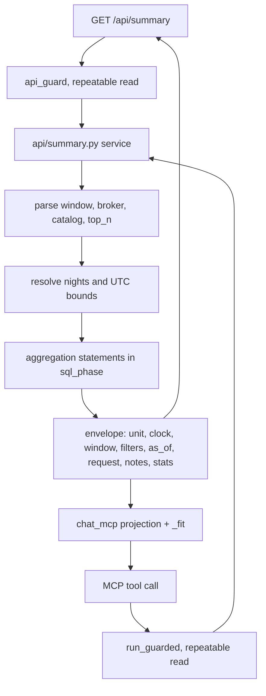
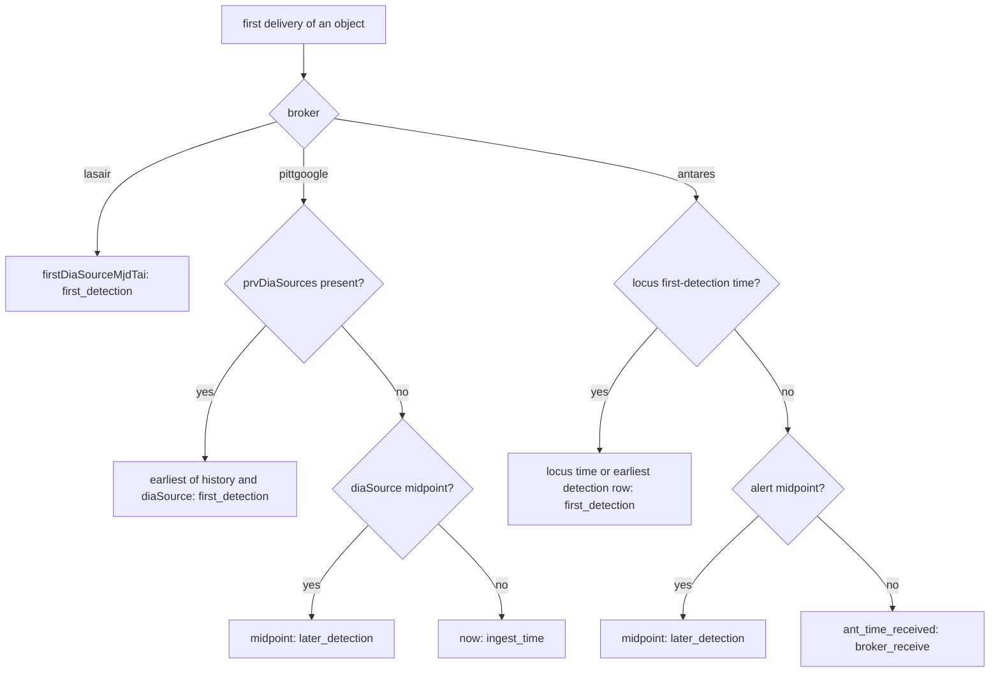

# Alert Window Statistics - Plan

## Goal Capsule

- **Objective:** Anyone using the public chat connector, whether a science user or the operator, can ask in plain language how many Rubin objects arrived over a recent night or span, from which broker, with which catalog outcomes, and which were most reliable, and get an answer that names its own unit, clock, and window.
- **Means:** One public window-summary query in the REST API, projected by one new MCP tool, computed live from rows already stored (KTD1, KTD5), plus an ingest change that records best-available first-detection time and its basis per object (KTD9).
- **Product authority:** The maintainer. Product Contract decisions marked `session-settled` were made in the brainstorm and planning dialogue of 2026-10-20; the Product Contract wins on behavior, KTDs win on mechanism.
- **Stop conditions:** Stop and return to the maintainer if U7's measurement shows the 31-night summary cannot finish inside the guarded request budget (the rollup fallback is a product decision), or if implementing R20 would require changing the Lasair filter or any broker-side subscription.
- **Execution profile:** Standard. App repo changes only; the gitops ingress route addition is a maintainer step (Operational Notes).
- **Who finishes:** `ce-work` implements and verifies locally; the maintainer reviews, merges, tags, and pushes gitops.
- **Open blockers:** None.

---

## Product Contract

Product Contract preservation: changed: R2, R5, R9, R10, R11, R12, R16, R19, R20, R21 -- clarifications from planning research (default-night rule, a server-computed span form, a missing outcome bucket, null-reliability handling, broker spellings, answer metadata) plus the user-directed decision to record observation-time basis; no requirement removed or narrowed.

### Summary

Add a public window-summary query to the REST API and a matching MCP tool. Given a Rubin observing night (the latest started night by default), the N most recent nights, or a UTC span of up to 14 nights, with optional broker and single-catalog filters, it returns object counts with a per-night breakdown, per-broker counts and overlap, match outcomes by catalog, the reliability distribution, and the top N objects by reliability. Ingest records each new object's best-available first-detection time and which basis that time came from, so answers say exactly how each object was placed.

### Problem Frame

Nobody can answer basic "what came in" questions about the service today, including the maintainer. Questions like "how many alerts were processed from Lasair last night?", "which alert from last night had the highest reliability?", or "how many alerts were processed in the last week?" have no route: the only time-window query (`/api/recent-crossmatches`) drops objects without a match, rejects counts and filters, and the MCP connector deliberately left that feed out. Grafana's ingest counter is gated, process-local, resets on restart, and counts deliveries rather than objects.

Two facts about stored data shape what any answer can mean. The service keeps one row per Rubin object (diaObjectId), not per detection, and records only the first delivery from each broker; repeat detections leave no trace. Reliability is captured once, from whichever broker delivered the object first. Separately, the stored event time is not uniform: only Lasair stores the object's first-detection time. Pitt-Google stores the time of the detection that triggered its delivery and falls back to ingest wall-clock time when that field is missing; its payload's first-detection field is null in every stored alert and its detection history is present in about 0.5% of them. ANTARES stores its own receive time.

### Key Decisions

- **Count objects, not detections.** The stored model holds one row per object and first delivery per broker; counting detections would need new stored data that only starts at ship date. Governs R4. (session-settled: user-directed -- chosen over recording every delivery, or both units side by side: object counts cover all history with no new storage.)
- **One public surface for science users and the operator.** No sensitive pipeline data is exposed, so the tool lives on the existing unauthenticated API and connector. Governs R17. (session-settled: user-directed -- chosen over a public-only science framing or an operator-gated surface.)
- **Windows select by observation time.** "Last night" is a question about what Rubin saw, so objects fall into windows by their first detection's observation time, accepting that counts rise as late deliveries arrive. Governs R3, R7. (session-settled: user-directed -- chosen over ingest time or a caller-selectable clock.)
- **Accept a Rubin night or a span; "last night" means the latest Rubin night.** Chatbots otherwise guess the user's local time zone while Rubin observes from Chile. Governs R2, R5. (session-settled: user-directed -- chosen over UTC windows only or Rubin nights only.)
- **Up to 14 nights per request, broken down per night.** Bounds query cost on a public endpoint and lets "last week" show a nightly trend. Governs R2, R6. (session-settled: user-directed -- chosen over any span with totals only, or any span with auto-coarsening grain.) (session-settled: user-directed -- limit lowered from 31 to 14 nights after U7 measured 31-night filtered summaries at 4.2-5.1 s against the 5 s budget at ~35k objects/night; chosen over a larger route budget with a REST concurrency cap, shipping 31 as-is, or nightly rollups.)
- **One summary answer computed live, not focused tools or nightly rollups.** One tool keeps every number in an answer consistent with the others and fits the connector's rule that tools project single API calls; rollups stay a fallback if live aggregation proves too slow. Governs R1. (session-settled: user-approved -- chosen over separate count/top-N/distribution tools, and over stored per-night rollups with backfill and recompute rules.)
- **Fix observation time at ingest, without backfill.** Lets every broker share one clock from ship date forward at the smallest cost; older rows are disclosed rather than repaired. Governs R20, R21. (session-settled: user-directed -- chosen over a fix plus a 30-day payload backfill, or accepting receive time with a disclosure.)
- **Use best-available first-detection time and record its basis per object.** Pitt-Google alerts almost never carry first-detection time, so ingest takes the best time each payload offers and stores which basis it used; answers then count objects per basis instead of carrying a blanket caveat, and rows written before the fix are identifiable on every cluster. Governs R20, R21. (session-settled: user-directed -- chosen over the same ingest rule with a generic note and a per-cluster deploy-date setting, or fixing ANTARES only: exact disclosure counts and a data-derived cutover.)
- **Catalog filter supports "has a match" and an honest "has no match".** Negative answers never collapse searched-nothing-found, outside-footprint, and read-failed into one number. Governs R11, R13, R14. (session-settled: user-directed -- chosen over positive-only filtering or deferring catalog filters.)
- **Reuse the agent-ready API's catalog-filter meaning.** An object has a match in a catalog when it has at least one coincident source there, and filters spanning catalogs are rejected, exactly as lookup and cone queries already behave (`docs/plans/2026-09-28-0914-feat-agent-ready-api-core-plan.md` R13, R14). Governs R13, R15.

### Requirements

**Window and counting unit**

- R1. A single window-summary query returns, for one window, every statistic in R6-R11 together, all read from one consistent database snapshot.
- R2. The window is one Rubin observing night named by its dayObs date (the UTC date of a time minus 12 hours), the N most recent nights (N from 1 to 14), or a UTC start and end touching at most 14 nights; longer requests are rejected with an error naming the limit.
- R3. An object falls in a window when its stored observation time lies inside it.
- R4. Every count is a count of distinct Rubin objects, and every answer states that unit and notes that it differs from delivery counts such as the ingest metric.
- R5. With no window given, the query uses the most recent Rubin night that has begun observing, not the dayObs the clock names before that night starts.

**Statistics**

- R6. The answer gives the total number of objects in the window and the same count for each night it covers.
- R7. Every answer states that any night, however old, can still gain objects when a broker first delivers an object detected earlier, and flags as provisional the nights where most of that growth is still expected.
- R8. The answer gives per-broker object counts, where an object counts toward every broker that has delivered it, and the number of objects delivered by more than one broker.
- R9. The answer gives match outcomes per catalog (objects with a coincident source, objects searched with none, objects outside the footprint, objects whose read failed, objects not searched because their position was invalid, objects crossmatched before the catalog was in service) plus a count of objects not yet crossmatched, reported as pending.
- R10. The answer gives the reliability distribution (minimum, median, maximum, and a coarse histogram) and the top N objects by stored reliability, with N defaulting to 10 and capped at the connector's object maximum; objects with no stored reliability are counted separately and excluded from both, and ties rank by diaObjectId.
- R11. Objects crossmatched before per-catalog outcomes were recorded (v0.15.0) count as coincident where they have a match, and otherwise go in their own "outcome not recorded" bucket rather than as searched-with-none.

**Filters**

- R12. An optional broker filter restricts every statistic in the answer to objects that broker delivered, accepting common spellings of each broker's name.
- R13. An optional catalog filter restricts every statistic to objects with at least one coincident source in that catalog, or to objects without one.
- R14. A "without a match" catalog filter reports its result split by searched-with-none, outside-footprint, read-failed, not-searched-invalid-position, not-in-service-at-crossmatch, outcome-not-recorded (R11), and pending, never as a single total; pending objects belong to neither the with-a-match nor the without-a-match result.
- R15. A request filtering on more than one catalog is rejected with an error naming the conflicting parameters, matching the existing query paths.

**Answer honesty**

- R16. The top-N list returns diaObjectIds as exact strings that the existing lookup tool accepts, with each object's Lasair and ANTARES links, and states that each reliability is the score captured from whichever broker delivered the object first (for Lasair, its latest-detection score).
- R17. The query is public and unauthenticated on both the API and the connector, stays within their existing concurrency caps and result-size limits, and its REST route carries the stricter per-IP query-route edge limit already applied to lookup, cone, and TNS queries.
- R18. When a window holds no objects, the answer says so and reports the observation time and night of the most recent object the service holds.
- R19. The answer echoes the window it used (night, nights, or UTC bounds), the clock (observation time), any filters applied, the moment it was computed, and the REST request that reproduces it.

**Observation-time correction**

- R20. From the fix forward, ingest records for each new object the earliest detection time its first delivery carries (an object-level first-detection time, else the earliest detection in the alert's history, else the triggering detection), and records which of those bases it used.
- R21. Each answer reports how many objects in the window were placed by first-detection time, by a later detection, by broker receive time, by ingest time, or before the basis was recorded, and states that objects not placed by first-detection time may sit in a later night than their first detection; no backfill is performed.

### Acceptance Examples

- AE1. **Covers R2, R5, R18, R19.** **Given** Rubin has been offline for weeks and the latest stored object was observed on 2026-09-14. **When** a user asks "how many alerts came in last night?" with no window. **Then** the answer reports zero objects for the most recent started Rubin night, names that night and the observation-time clock, and states that the most recent object was observed 2026-09-14.
- AE2. **Covers R3, R8.** **Given** an object first detected on dayObs 2026-11-02, first delivered by ANTARES, and delivered by Lasair a week later. **When** a user asks for counts for dayObs 2026-11-02. **Then** the object counts once in the total, once for ANTARES, once for Lasair, and once in the multi-broker overlap; it does not appear in the night Lasair delivered it.
- AE3. **Covers R12, R16.** **Given** a Lasair-delivered object first delivered by Pitt-Google with reliability 0.97. **When** a user asks for the most reliable Lasair object last night. **Then** it may rank first on 0.97, and the answer states that the score came from the first delivering broker.
- AE4. **Covers R13, R14, R11.** **Given** a night with objects that DELVE searched and found nothing near, objects outside the DELVE footprint, and objects crossmatched before v0.15.0 without a DELVE match. **When** a user asks how many objects had no DELVE match. **Then** the answer gives three separate counts and does not present their sum as "no DELVE match".
- AE5. **Covers R7.** **Given** the latest Rubin night ended two hours ago. **When** a user asks for that night's count. **Then** the night is flagged provisional because late deliveries can still raise it.
- AE6. **Covers R2.** **Given** a request for the last 60 days. **When** it is submitted. **Then** it is rejected with an error naming the 14-night limit, which the chatbot can relay and retry as shorter spans.
- AE7. **Covers R21.** **Given** a week in which some objects were ingested before the basis was recorded and others after. **When** a user asks for per-night counts. **Then** the answer counts the objects per basis, including "before the basis was recorded", and states that those not placed by first-detection time may sit in a later night.
- AE8. **Covers R7.** **Given** a Lasair-first object whose first detection was three weeks before Lasair delivered it. **When** a user asks for the count of that earlier night after the delivery. **Then** the night's count has risen by one, and the answer carries the statement that any night can still gain objects.
- AE9. **Covers R5.** **Given** the clock reads 15:00 UTC on 2026-11-03, before that evening's observing has begun. **When** a user asks about "last night" with no window. **Then** the answer covers dayObs 2026-11-02, not 2026-11-03.
- AE10. **Covers R20, R21.** **Given** a Pitt-Google alert with no detection history and a diaSource midpoint, and a later alert for a different object whose history shows an earlier detection. **When** both are ingested after the fix. **Then** the first object is stored by its triggering detection with basis "later detection" and the second by its earliest historical detection with basis "first detection".

### Scope Boundaries

- Per-detection or per-delivery counts, and per-detection reliability.
- Windows longer than 14 nights, and breakdowns coarser than per night.
- Ops and pipeline-health statistics (batch timings, queue depth, publish latency).
- Filters on catalog properties (parallax, RUWE, redshift, and so on) in the summary.
- Filters combining more than one catalog.
- Listing every object in a window (only the top N is returned).
- Backfilling observation time or basis for existing rows.
- Correcting an object's stored time when a later broker delivers an earlier detection; the time stays first-seen. Considered and not built: overlap between first-delivering Pitt-Google and later Lasair deliveries was 133 of 20,847 objects in the dev history, so the gain is small; revisit if overlap grows.
- Storing a missing observation time as missing; alerts without one keep the ingest-time stamp with basis "ingest time".
- Stored nightly rollups (held as a fallback, per the Key Decision on live computation).
- Changes to `/api/recent-crossmatches` and to the describe tool's output beyond the new limit.
- MCP `structuredContent` and per-tool `outputSchema` (still deferred per the MCP connector plan).

#### Deferred to Follow-Up Work

- Gitops: add the new route to the query-route rate-limit list (maintainer push; see Operational Notes).

### Dependencies / Assumptions

- Rows, event times, reliability, deliveries, and match history survive payload retention indefinitely; the sweep in `crossmatch/tasks/retention.py` nulls only payloads, and no task deletes alerts.
- Per-catalog search outcomes exist only for objects crossmatched since v0.15.0 (agent-ready API plan R18); earlier objects have none.
- ANTARES alert properties carry only the triggering detection's time (`ant_mjd`, `lsst_diaSource_midpointMjdTai`); a first-detection time is expected at the locus level (`oldest_alert_observation_time`, or the minimum of the locus lightcurve's `ant_mjd`), which is present in antares-client test data but unverified on streamed loci.
- Pitt-Google's `diaObject.firstDiaSourceMjdTai` is null in all 20,847 Pitt-Google-first alerts in the dev history, and `prvDiaSources` is present in 109; Lasair's first detection precedes its delivery by a median 3.4 days (90th percentile 5.4 days).
- The stricter query-route rate limit is applied by a hard-coded route list in the gitops repo (`../crossmatch-service-k8s-gitops`, `apps/crossmatch-service/templates/ingress.yaml`); R17 requires adding the new route there, which the maintainer pushes and syncs with the release.
- Rubin alerts have been paused since mid-September 2026, so live verification on PROD waits for alerts to resume; local dev history (about 114,000 objects, December 2025 to May 2026) and fixtures carry acceptance until then.

### Outstanding Questions

**Deferred to Implementation**

- Whether streamed ANTARES loci carry `oldest_alert_observation_time`, checked by logging the locus property keys on DEV once alerts resume; U1's fallback order keeps ingest correct either way.
- The final SQL shape of the aggregation after U7's measurement.

### Sources / Research

- `crossmatch/core/models.py` -- `Alert` (unique diaObjectId, `event_time`, first-seen `reliability`, indexes on `event_time` and `reliability`), `AlertDelivery`, `CatalogMatch`, `ObjectCrossmatchRecord` (`catalog_outcomes`, `match_version`), `CatalogSearchOutcome`.
- `crossmatch/brokers/normalize.py`, `crossmatch/brokers/__init__.py`, `crossmatch/brokers/antares/consumer.py` -- per-broker time sources, first-seen capture, the consumer reading `locus.alerts[0].properties`.
- `crossmatch/core/db.py` `read_only_transaction` and `crossmatch/api/guard.py` -- READ COMMITTED today, statement timeout set by a query.
- `crossmatch/api/lookup.py` (`_crossmatch_block`, status derivation), `crossmatch/api/filters.py` (catalog filter, `qualify_objects`, `count_body`), `crossmatch/api/contract.py` (`ReadTimeCatalogOutcome`, `CODE_DESCRIPTIONS`, `envelope`, `dia_object_id_fields`), `crossmatch/core/provenance.py` (broker list).
- `crossmatch/chat_mcp/tools.py`, `crossmatch/chat_mcp/projection.py` (`_fit`, `_links`), `crossmatch/chat_mcp/views.py` (`INSTRUCTIONS`), `crossmatch/chat_mcp/limits.py`.
- `docs/solutions/integration-issues/create-index-concurrently-deadlocks-under-locked-init.md`; `docs/solutions/design-patterns/coerce-numpy-pandas-scalars-to-json.md`.
- `docs/plans/2026-09-28-0914-feat-agent-ready-api-core-plan.md`; `docs/plans/2026-10-05-0831-feat-mcp-chat-connector-plan.md`.

---

## Planning Contract

### Key Technical Decisions

- KTD1. **One service function in a new `crossmatch/api/summary.py`, shared by REST and MCP.** It parses raw parameter strings, validates, aggregates, and returns an enveloped JSON-native body; the view and the MCP tool both call it, so names, defaults, caps, spellings, and error codes cannot drift. Route `api/summary` (operationId `summarize_rubin_transients_by_night`), chosen because the gitops rate-limit list matches by prefix and must not collide with `lookup`, `cone`, or `tns`. Governs R1, R17.
- KTD2. **Night arithmetic is UTC-only and server-side.** dayObs(t) is the UTC date of t minus 12 hours; night D spans [D 12:00Z, D+1 12:00Z). A night D has begun once the clock passes D + `SUMMARY_NIGHT_ROLLOVER_HOURS` (default 23, so D 23:00Z, when the evening's observing starts). The default night is the latest begun night, the UTC date of (now minus 23 hours), and KTD3 uses the same begun test to reject an explicit night. Governs R2, R5; covers AE9.
- KTD3. **Three mutually exclusive window forms: `night`, `last_nights`, `start`+`end`.** Supplying more than one is `invalid_parameter`. A span is half-open `[start, end)`, ISO-8601 with naive values read as UTC (the existing `_parse_timestamp` rule, moved to a shared helper), and counts every dayObs it touches toward the 14-night limit (`SUMMARY_MAX_NIGHTS`, default 14); edge nights a span cuts are flagged `partial`. A requested night that has not begun (KTD2's begun test) is rejected, as is a span or `last_nights` window ending after the latest begun night. Governs R2, R6.
- KTD4. **Snapshot consistency through an opt-in REPEATABLE READ guarded transaction.** `read_only_transaction` gains an isolation argument issued as `SET TRANSACTION ISOLATION LEVEL REPEATABLE READ, READ ONLY` before the statement-timeout query, and `api_guard` passes it through only for routes that ask. Chosen over one monolithic SQL statement: it keeps the aggregation readable as several statements and leaves every existing route unchanged. Governs R1.
- KTD5. **Aggregation in raw SQL under `sql_phase`, a handful of statements over one filtered window set.** Statements: per-night totals with provisional and partial flags; per-broker counts and overlap from deliveries; reliability min/median (`percentile_cont`)/max, a 10-bin histogram on [0, 1], and the no-score count; per-catalog outcome counts from the current crossmatch record's outcomes plus current-version matches; basis counts; top N ordered by reliability descending then diaObjectId; and, for an empty window, the latest stored observation time. Table and column names come from model `_meta`, as in `api/filters.py`. Governs R6, R8, R9, R10, R21, R18.
- KTD6. **Outcome buckets reuse existing contract codes.** Per-catalog buckets are `coincident_sources`, `outside_footprint`, `skipped_read_failure`, `not_searched_invalid_position`, `not_in_service_at_crossmatch`, `not_recorded`, plus one new code `searched_no_match` added to the contract enum and `CODE_DESCRIPTIONS`; pending uses `crossmatch_pending`. Status derivation mirrors `api/lookup.py` so a number means the same thing when the chatbot chains to lookup. A "without" catalog filter returns the buckets with no total key. Governs R9, R11, R14.
- KTD7. **Catalog filter is `catalog` plus `catalog_match=with|without`.** `catalog` values are validated against `CROSSMATCH_CATALOGS` with the `api/filters.py` rules; a repeated `catalog` raises `filters_span_catalogs` with `params`; `catalog_match` without `catalog` is `invalid_parameter`; other filter parameters are rejected as unsupported here. Governs R13, R15.
- KTD8. **Broker parameter normalizes spellings.** Values are lowercased with non-alphanumerics removed and matched against the broker list from `core/provenance.py`, so "Pitt-Google" and "ANTARES" work on both surfaces; an unknown value errors with the valid list. Governs R12.
- KTD9. **Observation-time basis is a nullable text column on `Alert`, written at first delivery.** Values `first_detection`, `later_detection`, `broker_receive`, `ingest_time`; NULL means "before the basis was recorded". Each normalizer returns the time and its basis, and `ingest_alert` writes both only in `get_or_create` defaults, keeping them first-seen. Lasair yields `first_detection`; Pitt-Google uses the earliest of `prvDiaSources` and `diaSource` midpoints (`first_detection` when history is present, else `later_detection`), then the existing ingest fallback (`ingest_time`); ANTARES uses the locus first-detection time (`oldest_alert_observation_time`, else the minimum `ant_mjd` over lightcurve rows that are detections, with a non-null `ant_mag` and not upper-limit or forced-photometry rows) as `first_detection`, else the alert's own midpoint (`later_detection`), else `ant_time_received` (`broker_receive`). The column is added with a plain nullable `AddField`, which Postgres applies without a table rewrite and without an index. Governs R20, R21; covers AE10. (session-settled: user-directed -- chosen over a generic disclosure with a per-cluster deploy-date setting, or fixing ANTARES only: exact basis counts and a cutover derived from the data.)
- KTD10. **A night is provisional while it ended less than `SUMMARY_PROVISIONAL_DAYS` (default 6) before the query moment.** Six days covers Lasair's measured 90th-percentile delay from first detection to delivery (5.4 days). Governs R7.
- KTD11. **The MCP tool is a thin projection named `summarize_rubin_transients_by_night`.** Its schema enums (broker, catalog) and `top_n` maximum (`MCP_MAX_OBJECTS`) are built from settings at call time; its description maps "last night" to no window, "this week" to `last_nights=7`, display catalog names to codes, and forbids local-time shifting; top-N entries carry `_links` and a hint to pass the IDs as strings to `lookup_rubin_transients`; the projection runs through `_fit`, dropping top-N entries from the end if the size cap is ever reached. `INSTRUCTIONS` in `chat_mcp/views.py` gains one sentence routing count and "last night" questions to it. Governs R16, R17, R19.
- KTD12. **No new error codes.** Window and parameter errors reuse `invalid_parameter` with `param`/`params`; multi-catalog reuses `filters_span_catalogs`; over-budget stays `query_too_expensive`. This keeps the two-way OpenAPI completeness tests passing without new error vocabulary. Governs R2, R15.
- KTD13. **The 14-night limit is published in the describe document's limits.** Models then discover it before hitting it; the key is added to `_limits()` and to the `ServiceDescription.limits` required list. Governs R2.

### High-Level Technical Design

Request path, shared by both surfaces:

Observation-time basis at ingest:

### Assumptions

- Postgres applies a nullable `AddField` without rewriting `core_alert`, so the migration does not block ingest under `locked_init`.
- `percentile_cont` over up to a few hundred thousand rows per window fits the budget; U7 verifies this before the route ships.

---

## Implementation Units

### U1. Record observation-time basis at ingest

**Goal:** New objects store their best-available first-detection time and the basis it came from.

**Requirements:** R20, R21; KTD9; covers AE10.

**Dependencies:** None.

**Files:**
- `crossmatch/core/models.py` (basis choices and nullable field on `Alert`)
- `crossmatch/core/migrations/0013_alert_event_time_basis.py`
- `crossmatch/brokers/normalize.py`
- `crossmatch/brokers/__init__.py` (`ingest_alert` writes basis in `get_or_create` defaults)
- `crossmatch/brokers/antares/consumer.py` (pass the locus first-detection time to the normalizer)
- `crossmatch/tests/test_read_model_ingest.py`, `crossmatch/tests/test_broker_decoding.py`
- `crossmatch/tests/fixtures/brokers/antares_locus.json`, `crossmatch/tests/fixtures/brokers/pittgoogle_alert.json` (add `oldest_alert_observation_time`, `prvDiaSources`)

**Approach:**
1. Add the basis `TextChoices` beside `Alert.Status` and the nullable field; generate migration 0013 as a plain `AddField` with no index.
2. Change each normalizer to return `event_time` and `event_time_basis` per KTD9's order, extracting history defensively so a malformed history falls through to the next source rather than raising.
3. Give `normalize_antares` an optional locus-level first-detection argument; the consumer reads it from `locus.properties` or the lightcurve and passes it.
4. Write the basis in `ingest_alert` defaults only, so repeat deliveries leave it unchanged.

**Patterns to follow:** `_MJD_EPOCH` conversion in `brokers/normalize.py`; first-seen defaults in `brokers/__init__.py`; `_antares_raw` / `_pittgoogle_payload` helpers in `tests/test_read_model_ingest.py`.

**Execution note:** Keep the severed-connection ingest regression test green; the change stays inside the shared `ingest_alert` path.

**Test scenarios:**
- Lasair alert stores `firstDiaSourceMjdTai` as event time with basis `first_detection`.
- Covers AE10. Pitt-Google alert with `prvDiaSources` stores the earliest midpoint across history and diaSource with basis `first_detection`.
- Covers AE10. Pitt-Google alert without `prvDiaSources` stores the diaSource midpoint with basis `later_detection`.
- Pitt-Google alert with neither midpoint nor history stores ingest time with basis `ingest_time`.
- Pitt-Google alert whose `prvDiaSources` holds malformed entries falls back to the diaSource midpoint without raising.
- ANTARES locus with `oldest_alert_observation_time` stores it with basis `first_detection`.
- ANTARES locus without it but with a lightcurve stores the minimum `ant_mjd` over detection rows with basis `first_detection`.
- ANTARES lightcurve whose earliest row is an upper limit stores the earliest detection row's time, not the upper limit's.
- ANTARES lightcurve with no detection rows falls through to the alert midpoint with basis `later_detection`.
- ANTARES alert with no locus time stores its own midpoint with basis `later_detection`, and with no midpoint stores `ant_time_received` with basis `broker_receive`.
- A second delivery of an existing object from another broker leaves event time and basis unchanged.
- Decoding through the real antares-client and pittgoogle decoders with the extended fixtures yields the expected basis.
- Migration graph has a single leaf (`makemigrations --check` clean).

**Verification:** Normalizer and decoder tests pass; a fresh object in the local stack shows a non-null basis; existing rows read NULL.

### U2. Snapshot-consistent guarded transaction

**Goal:** A guarded route can opt into REPEATABLE READ so all its statements see one snapshot.

**Requirements:** R1; KTD4.

**Dependencies:** None.

**Files:**
- `crossmatch/core/db.py`
- `crossmatch/api/guard.py` (`api_guard` and `run_guarded` accept and pass the isolation option)
- `crossmatch/tests/test_api_guard.py`

**Approach:** Add an optional isolation argument to `read_only_transaction` that sets isolation and read-only in one `SET TRANSACTION` statement before the statement-timeout query; thread it through `api_guard` and `run_guarded` with the current behavior as the default. Postgres accepts an isolation level only as the first statement of a top-level transaction, so `read_only_transaction` raises a clear error when isolation is requested inside an existing atomic block, and every test that runs a repeatable-read guarded call (here, U5, and U6) uses `@pytest.mark.django_db(transaction=True)`.

**Patterns to follow:** Existing `api_guard` options and the `transaction=True` guard tests.

**Test scenarios:**
- A view guarded with repeatable read reports `transaction_isolation` as `repeatable read` and `transaction_read_only` as `on`.
- A view guarded without the option still reports `read committed`, so existing routes are unchanged.
- The statement timeout is still applied under repeatable read (an over-budget query still yields `query_too_expensive`).
- Two reads inside one repeatable-read guarded call do not see a row committed between them by another connection.
- Requesting repeatable read inside an already-open atomic block raises the clear error rather than a database error.

**Verification:** Guard tests pass, including the existing ones untouched.

### U3. Window parsing and night arithmetic

**Goal:** Raw parameters become a validated window (nights, UTC bounds, flags) and filters, with the errors the contract names.

**Requirements:** R2, R5, R12, R13, R15; KTD2, KTD3, KTD7, KTD8, KTD12; covers AE6, AE9.

**Dependencies:** None.

**Files:**
- `crossmatch/api/summary.py` (parse layer)
- `crossmatch/api/timeparse.py` (shared ISO-8601 helper moved from `api/views.py`; `api/views.py` imports it)
- `crossmatch/project/settings.py` (`SUMMARY_MAX_NIGHTS`, `SUMMARY_NIGHT_ROLLOVER_HOURS`, `SUMMARY_PROVISIONAL_DAYS`, `SUMMARY_DEFAULT_TOP_N`)
- `crossmatch/tests/test_summary_window.py`

**Approach:** Pure functions taking raw strings and a `now`, returning a frozen window and filter value object; no database access. Settings are read at call time.

**Patterns to follow:** `api/service.py` window checks; `api/filters.py` `parse_filters` and `filters_span_catalogs`; `InvalidQuery(..., param=...)`.

**Test scenarios:**
- Covers AE9. With no window at 15:00Z on 2026-11-03 the default night is 2026-11-02; at 23:30Z it is 2026-11-03; at 03:00Z on 2026-11-04 it is 2026-11-03.
- `night=2026-11-02` resolves to [2026-11-02T12:00Z, 2026-11-03T12:00Z).
- `last_nights=7` resolves to the seven nights ending at the default night.
- A span from 2026-11-01T00:00Z to 2026-11-03T00:00Z touches three dayObs and flags the first and last partial.
- Covers AE6. A 60-day span, `last_nights=32`, and a span touching 32 nights each return `invalid_parameter` naming 31.
- `end` before `start`, a malformed timestamp, `night` with `start`, and a night that has not begun each return `invalid_parameter` naming the parameter.
- At 15:00Z on 2026-11-03, `night=2026-11-03` is rejected as not begun; at 23:30Z it is accepted.
- A naive timestamp is read as UTC.
- `broker=Pitt-Google`, `broker=ANTARES`, and `broker=pitt google` normalize; `broker=ztf` errors listing the valid brokers.
- Two `catalog` values return `filters_span_catalogs` with both names in `params`; `catalog_match=without` alone returns `invalid_parameter`; `catalog=gaia` (unknown) errors with the configured names.
- `top_n` above the cap, zero, or non-integer returns `invalid_parameter`.

**Verification:** Window tests pass with a frozen clock and no database.

### U4. Summary aggregation service

**Goal:** For a parsed window and filters, compute every statistic from one snapshot and return the enveloped body.

**Requirements:** R1, R3, R4, R6-R11, R13, R14, R16, R18, R19, R21; KTD1, KTD5, KTD6, KTD10; covers AE1-AE5, AE7, AE8.

**Dependencies:** U1, U3.

**Files:**
- `crossmatch/api/summary.py` (service function and SQL)
- `crossmatch/api/contract.py` (`searched_no_match` code and description)
- `crossmatch/tests/test_summary_service.py`

**Approach:**
1. Build the window object set once (event time in bounds, broker and catalog filters applied) and reuse it across the KTD5 statements inside `sql_phase`, calling `check_deadline` between them.
2. Derive per-catalog buckets the way `api/lookup.py` derives them, including `not_in_service_at_crossmatch` for catalogs absent from a current record and coincident status for pre-v0.15.0 objects with matches.
3. Coerce every numeric to a JSON-native type, emit null (not NaN) for empty distributions, and emit IDs through `dia_object_id_fields`.
4. Lead the body with unit, clock, window (nights, bounds, partial flags), filters, `as_of`, and the reproducing REST request, followed by keyed notes that appear only when they apply, then the statistics.

**Patterns to follow:** `api/filters.py` raw SQL and `count_body` zero-filled buckets; `api/lookup.py` status derivation; `api/contract.py` `envelope`.

**Test scenarios:**
- Covers AE2. An object first detected on night D, delivered by ANTARES then Lasair, counts once in the total, once per broker, and once in overlap for night D only.
- Covers AE3. With `broker=lasair`, a Lasair-delivered object first delivered by Pitt-Google ranks on its stored score and the note names first-broker capture.
- Covers AE4. With `catalog=delve_dr3_gold&catalog_match=without`, searched-none, outside-footprint, and not-recorded objects land in separate buckets and the body has no total key.
- A pre-v0.15.0 object with a Gaia match counts as `coincident_sources` for Gaia, and without one as `not_recorded`.
- An object whose record predates a catalog lands in `not_in_service_at_crossmatch` for that catalog.
- INGESTED and QUEUED objects count as `crossmatch_pending` and appear in neither catalog-filter result.
- Objects with null reliability are counted under no-score and excluded from min/median/max, the histogram, and the top N; equal scores rank by diaObjectId.
- Top N defaults to 10, honors `top_n`, and returns IDs above 2^53 exactly as strings.
- Covers AE5. A night that ended two hours before `as_of` is provisional; one that ended eight days before is not.
- Covers AE8. Adding a Lasair-first object first detected three weeks earlier raises that old night's count by one.
- Covers AE7. A window mixing NULL-basis and recorded-basis objects reports counts per basis including "before the basis was recorded".
- Covers AE1. An empty window returns zero totals, null distribution values, and the latest stored observation time and its night.
- Per-night totals sum to the window total, and per-catalog buckets plus pending sum to the window total for each catalog.

**Verification:** Service tests pass against the test database; the body serializes with `json.dumps` and `allow_nan=False`.

### U5. REST route, OpenAPI, and discovery surfaces

**Goal:** `GET /api/summary` serves the service body under the guard, documented everywhere the API is described.

**Requirements:** R17, R19; KTD1, KTD4, KTD12, KTD13.

**Dependencies:** U2, U4.

**Files:**
- `crossmatch/api/urls.py`, `crossmatch/api/views.py`
- `crossmatch/api/openapi.py` (path item, parameters with `x-unit`, response schemas)
- `crossmatch/api/discovery.py` (`_limits()` gains the night limit), `crossmatch/api/openapi.py` `ServiceDescription.limits` required list
- `crossmatch/tests/test_summary_view.py`, `crossmatch/tests/test_openapi_completeness.py`, `crossmatch/tests/test_llms_txt.py`, `crossmatch/tests/test_api_describe.py`

**Approach:** Follow `cone_search_view`: `@api_guard` with repeatable read, method check, raw `request.GET` passed to the service. Add the operation to the guarded-set assertion. Keep `/llms.txt` under its 10 KB cap by keeping the operation description short.

**Patterns to follow:** `cone_search_view`, `resolve_tns_view`; `_paths()` and `_query_param` in `api/openapi.py`. View tests use `@pytest.mark.django_db(transaction=True)` (U2).

**Test scenarios:**
- A GET with `night=` returns 200 and a body that `openapi_validate` accepts.
- A GET with no parameters returns the default night.
- POST returns 405.
- An invalid parameter returns 400 with `code` and `param`, validated against the documented error schema.
- The route is slashless and mounted at `/api/summary`.
- `/llms.txt` lists the operation and stays under 10 KB; OpenAPI completeness passes in both directions; describe lists the night limit.

**Verification:** View, OpenAPI, llms.txt, and describe tests pass.

### U6. MCP summary tool

**Goal:** Chat clients can call `summarize_rubin_transients_by_night` and relay a faithful, compact answer.

**Requirements:** R16, R17, R19; KTD11.

**Dependencies:** U2, U4.

**Files:**
- `crossmatch/chat_mcp/tools.py`, `crossmatch/chat_mcp/projection.py`, `crossmatch/chat_mcp/views.py` (`INSTRUCTIONS`)
- `crossmatch/api/docs.py` (connector intro no longer hard-codes "three tools")
- `crossmatch/tests/test_chat_mcp_tools.py`, `crossmatch/tests/test_chat_mcp_projection.py`, `crossmatch/tests/test_chat_mcp_protocol.py`

**Approach:** `parse` reuses the U3 parser and converts `InvalidQuery` to `ToolArgumentError`; `run` calls the U4 service once under `run_guarded` with repeatable read; the projection is pure and keeps the leading unit/clock/window/filters/`as_of` block, compacts statistics, and adds links and the lookup hint to each top-N entry.

**Patterns to follow:** `_parse_near`/`_run_near` in `chat_mcp/tools.py`; `_fit`, `_links`, `_cone_request` in `chat_mcp/projection.py`. Tool tests that run the service use `@pytest.mark.django_db(transaction=True)` (U2).

**Test scenarios:**
- `tools/list` returns four tools; the new schema's broker and catalog enums match settings and `top_n.maximum` equals `MCP_MAX_OBJECTS`.
- A call with no arguments returns the default night's projection with every top-N `diaObjectId` as a string and links present.
- On one fixture database, every count in the projection equals the REST body's, and the projection's request URL reproduces that body.
- An over-cap `top_n` and a 60-night request each return an `isError` result naming the limit.
- A forced size cap drops top-N entries from the end and marks the answer truncated.
- `INSTRUCTIONS` names the new tool; the tool-call log line records the tool, counts, and outcome.

**Verification:** MCP tool, projection, and protocol tests pass.

### U7. Measure the 31-night summary against the budget

**Goal:** Know before shipping whether the live query fits the guarded request budget at realistic volume.

**Requirements:** R1; KTD5; Goal Capsule stop condition.

**Dependencies:** U4.

**Files:**
- None required; any measurement script stays out of the repo unless it proves reusable.

**Approach:** Against the local dev database (about 114,000 objects), time the U4 statements with `EXPLAIN (ANALYZE, BUFFERS)` for a 31-night window, then repeat on a scaled copy (rows duplicated with offset IDs and times to reach roughly 1 million objects in 31 nights). Add an index only if a plan shows a sequential scan the existing `event_time` index should have served, and then as its own concurrent-index migration per `docs/solutions/integration-issues/create-index-concurrently-deadlocks-under-locked-init.md`.

**Test expectation:** none -- measurement, not behavior.

**Verification:** Recorded timings show the full 31-night summary under the guarded budget at the scaled volume, or the run stops for the maintainer per the Goal Capsule.

### U8. Changelog and glossary

**Goal:** The release notes and domain vocabulary describe the new query and basis.

**Requirements:** R20, R21.

**Dependencies:** U1, U5, U6.

**Files:**
- `CHANGELOG.md` (`[Unreleased]`: summary query, MCP tool, observation-time basis, migration 0013)
- `CONCEPTS.md` (Observing night default rule; observation-time basis; reliability captured at first delivery)

**Approach:** Land entries under `[Unreleased]` per the project convention.

**Test expectation:** none -- documentation.

**Verification:** Entries present and consistent with the shipped behavior.

---

## System-Wide Impact

- **Shared transaction helper:** U2 touches the helper every guarded view uses; the default path must stay byte-for-byte equivalent.
- **Ingest path:** U1 changes all three normalizers and the ANTARES consumer; a normalizer exception discards a Pitt-Google alert and skips an ANTARES locus, so extraction must fall through, never raise.
- **Schema:** one nullable column on the largest table, applied by `locked_init` on every cluster at startup.
- **Public surface:** a new REST operation and MCP tool change `/llms.txt`, `/api/describe`, the OpenAPI document, and the connector's server instructions.
- **Connector load:** the summary is the most expensive connector call; it holds one of `MCP_MAX_CONCURRENT` slots for its duration.

## Risks & Dependencies

| Risk | Mitigation |
|---|---|
| 31-night aggregation exceeds the 5 s budget at PROD volume | U7 measures before ship; stop condition returns the rollup decision to the maintainer |
| Streamed ANTARES loci lack a first-detection field | KTD9 fallback order still stores the alert midpoint with an honest basis |
| New route ships before the gitops rate-limit change | Operational Notes order the gitops push with the release |
| `/llms.txt` exceeds 10 KB | Short operation description; test pins the cap |
| Migration renumbering on rebase | Check `makemigrations --check` after rebasing onto main |

## Documentation / Operational Notes

- **Rollout order:** merge and tag; in the gitops repo add `summary` to the `range list "lookup" "cone" "tns"` in `apps/crossmatch-service/templates/ingress.yaml`; bump the image tag on DEV, sync, verify, then PROD. The maintainer pushes both repos.
- **After deploy:** confirm migration 0013 applied (`event_time_basis` column present, existing rows NULL); once alerts resume, check new rows carry a basis and log one ANTARES locus's property keys to settle the deferred field question.
- **Live check on DEV:** from Claude.ai and ChatGPT ask "how many alerts from Lasair last night?", "most reliable object last night?", "how many this week?", "how many had no DELVE match last night?", and "last 60 days?"; pass when the model picks parameters without inventing dates, states objects and observation night, does not sum the no-match buckets, recovers from the 60-day error, and offers a lookup for the top object.

---

## Verification Contract

| Gate | Command or check | Applies to |
|---|---|---|
| Test suite | `docker compose --env-file docker/.env -f docker/docker-compose.yaml run --rm --no-deps celery-worker sh -c 'pip install -q -r requirements.dev.txt && python -m pytest'` | All units |
| Migration graph | `python manage.py makemigrations --check --dry-run` in the same container | U1, U7 |
| Formatting | `black` on changed Python files only | All code units |
| Budget measurement | U7 timings recorded in the PR description | U7 |
| Lock drift | No dependency changes expected; if any pin changes, regenerate `crossmatch/requirements.lock` | All |

## Definition of Done

- Every unit's verification holds and the full test suite passes in-container.
- `makemigrations --check` reports no changes and a single leaf.
- U7 shows the 31-night summary within budget at scaled volume, or work has stopped for the maintainer.
- `CHANGELOG.md` `[Unreleased]` and `CONCEPTS.md` reflect the change.
- No abandoned-attempt code, debug logging, or measurement scripts remain in the diff.
- The gitops rate-limit step and rollout order are stated in the PR description for the maintainer.
