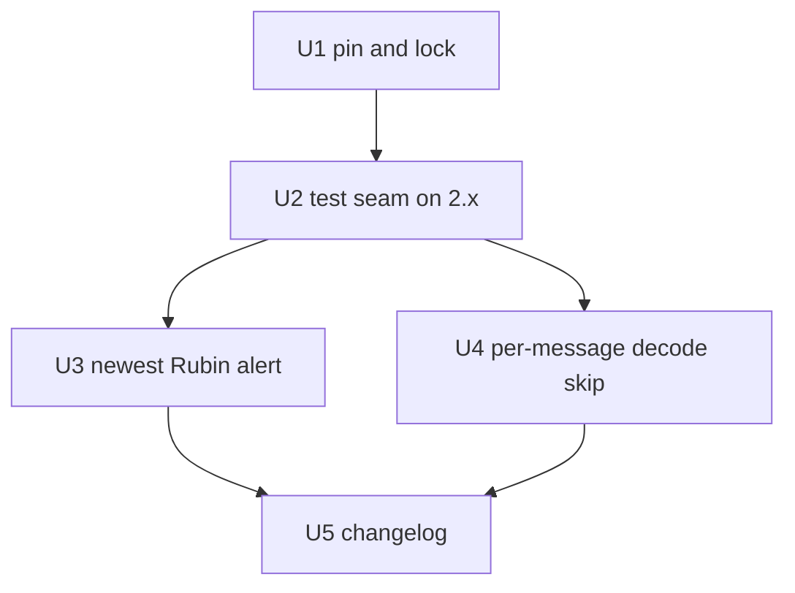

# ANTARES API v2 Upgrade - Plan

## Goal Capsule

- **Objective:** ANTARES Rubin alerts keep reaching the crossmatch service on DEV and PROD, without a gap, after ANTARES retires its v1 API on 2026-11-04, including the alerts on loci with older ZTF history that are dropped today.
- **Means:** upgrade antares-client from 1.14.0 to 2.0.2 (KTD1) and select the newest Rubin alert on each locus (KTD2).
- **Product authority:** this Product Contract. The release-vehicle and fallback decisions are user-directed (see Key Decisions). On product behavior the R-IDs win; on mechanism the KTDs win.
- **Execution profile:** one PR from a `bot` branch off `main` (KTD5), with units U1-U5 landing as separate commits. Release, deploy and the post-rollout checks (R9-R11) are run by the maintainer after merge (see Release and Rollout Notes).
- **Stop conditions:** stop and report if 2.0.2's decode or fetch surface differs from what KTD2-KTD4 rely on, if regenerating the lock moves any package other than antares-client and its dropped 1.x-only dependencies (R2), or if the in-container suite cannot be made green.
- **Open blockers:** none. External deadline: 2026-11-04. The fallback go/no-go is 2026-11-02 (R9), so PROD runs the upgraded client by 2026-11-03.

---

## Product Contract

Product Contract preservation: changed only in Sources and Outstanding Questions, with no scope change. Sources now says that the first-detection code lives on PR #124's branch, not `main`. The two deferred questions were resolved in place by KTD1 and KTD4.

### Summary

Upgrade the ANTARES client to 2.x with an exact pin and a regenerated lock, and fix the consumer so it ingests the locus's newest Rubin alert instead of skipping loci with older ZTF history. Rework the ANTARES tests so they no longer depend on client internals that 2.x removed. Ship it in v0.17.0 alongside PR #124. If #124 cannot reach PROD by 2026-11-02, cut v0.16.3 with only this fix.

### Problem Frame

ANTARES announced (scimma/crossmatch-service#125) that its v1 API stops being supported on 2026-11-04, and that antares-client users must move to 2.0 or later.

The ANTARES consumer receives loci over Kafka, but reading a locus's alerts is a lazy REST call to the v1 API in antares-client 1.14. After the cutoff, every ANTARES alert would fail inside the consumer's per-alert error handler and be skipped. The failure is easy to miss, because the consumer keeps running.

ANTARES is effectively PROD's only live feed today. As of 2026-10-26, PROD has recorded no Lasair deliveries since 2026-07-20, the Lasair consumer is logging Kafka fetch timeouts, and Pitt-Google has never delivered on PROD. Losing ANTARES on Nov 4 would therefore stop PROD ingest entirely.

The consumer is also already dropping most of ANTARES's Rubin traffic. It reads `locus.alerts[0]` as the newest alert, but the ANTARES API returns a locus's alerts oldest-first on both v1 and v2. Many Rubin transients fall on loci with years of ZTF history, so `alerts[0]` is an old ZTF alert with no `lsst_diaObject_diaObjectId`, and the whole message is skipped even though the locus holds the Rubin alert that triggered it.

On PROD from 2026-10-14 to 2026-10-26, the consumer logged 4,209 such skips across 1,538 distinct loci and recorded only 9 ANTARES deliveries. All 25 sampled skipped loci held Rubin alerts, and none of those Rubin objects has an ANTARES delivery. Example: locus ANT2020ceifa has 386 alerts, the oldest a 2019 ZTF upper limit, plus six Rubin alerts for diaObjectId 170446371625109043. In every sample the locus's newest alert was also ZTF.

### Key Decisions

- **Upgrade the client and keep the consumer's shape.** The REST fetch per alert stays, now against v2. Dropping REST entirely by decoding the alert from the stream message is deferred: we cannot confirm the stream carries the LSST fields (retention has nulled our stored payloads), and the deadline is nine days out. (session-settled: user-approved -- chosen over stream-only decoding: unverifiable payload shape under a nine-day deadline.) Governs R1, R3.
- **Ship in v0.17.0 together with PR #124.** (session-settled: user-directed -- chosen over a standalone v0.16.3 release now, and over merging to main and deciding the release later: the user prefers one release vehicle.) Governs R9.
- **Fix the alert selection in this change.** The consumer drops nearly all ANTARES Rubin traffic on PROD, and the upgrade already touches that code. (session-settled: user-directed -- chosen over keeping strict parity with today's oldest-alert selection and deferring the fix: PROD evidence showed 4,209 skips against 9 deliveries in 12 days.) Governs R3.
- **Fallback to v0.16.3 if #124 is not PROD-deployable by 2026-11-02.** The date was moved from 2026-11-03 in review (user-approved) to leave a full deploy day before the cutoff. (session-settled: user-directed -- chosen over accepting an ANTARES ingest gap until v0.17.0 ships: the cutoff must not leave PROD on 1.14.) Governs R9, R10.
- **Accept a second v2 call on the first-detection fallback path.** 2.x no longer fills the locus lightcurve from the stream message, so the fallback now fetches it. That path runs only when the locus property does not supply a Rubin first detection. (session-settled: user-approved -- chosen over reworking the first-detection logic: it is the uncommon path.) Governs R3, R7. Conflict call-out: the first-detection fallback exists only on PR #124's branch, so on `main` this decision has no code to govern yet. It takes effect when #124 and this change are reconciled (KTD5).
- **Pin the client exactly.** `requirements.base.txt` lists it unpinned today, against the repo's pin-every-dependency convention. (session-settled: user-approved -- chosen over keeping it unpinned: the convention exists to stop silent version drift.) Governs R2.

### Requirements

**Client and dependencies**

- R1. ANTARES ingest uses antares-client 2.0.2 or later, and nothing in the ingest path calls the v1 API.
- R2. The client is pinned to an exact version in `crossmatch/requirements.base.txt`, and `crossmatch/requirements.lock` is regenerated in the same commit, so dependencies that only 1.x needed (marshmallow, marshmallow-jsonapi) drop out of the lock and no pin shared with the Dask cluster changes.

**Behavior parity**

- R3. For each streamed locus, the consumer normalizes the locus's newest alert (by observation time) that carries `lsst_diaObject_diaObjectId`, and skips the locus only when no alert does. Normalization, first-detection time and `event_time_basis` stay as they are today.
- R4. The consumer ingests loci in both stream message formats that 2.x decodes (the current format and the newer one 1.14 rejects).
- R5. A stream message that 2.x cannot decode is logged and skipped without tearing down or recreating the Kafka consumer, as 1.14 skipped incomplete loci; the next valid locus still ingests.

**Tests**

- R6. The ANTARES decode, normalize and ingest tests run against 2.x without patching client internals that 2.x removed, and without network access. They include an undecodable message followed by a valid locus (R5), and a locus whose oldest and newest alerts are ZTF but which holds Rubin alerts (R3).
- R7. The tests cover the first-detection fallback, where the lightcurve now comes from a v2 fetch rather than the stream message, and confirm that only Rubin detection rows are used.

**Release and deployment**

- R8. The change lands on `main` through a `bot`-branch PR, with a `CHANGELOG.md` entry under `[Unreleased]` that names the v1 retirement date.
- R9. The fix ships in v0.17.0 together with PR #124. If #124 is not deployable to PROD by 2026-11-02, v0.16.3 is cut from v0.16.2 with only this fix added, so #124's gitops prerequisites do not gate it.
- R10. The release carrying the fix is deployed to DEV, then PROD, before 2026-11-04 by bumping the image tag in the gitops overlays.
- R11. Each cluster is checked right after its rollout, and DEV before PROD is promoted. The deployed consumer must be connected to the ANTARES Kafka stream. Then either real ANTARES alerts ingest under 2.x, or, if Rubin alerts are not flowing, a v2 check on one known Rubin locus shows two things: the alert the consumer selects carries `lsst_diaObject_diaObjectId`, and the fetched lightcurve yields a first-detection time.

### Acceptance Examples

- AE1. **Covers R3.** **Given** a streamed locus whose `oldest_alert_id` is a Rubin (`lsst:`) alert with a valid observation time, **when** it is ingested under 2.x, **then** `event_time` is that time with basis `first_detection`, and the only v2 call is the alert fetch.
- AE2. **Covers R3, R7.** **Given** a streamed locus whose oldest alert is from another survey (e.g. ZTF), **when** it is ingested, **then** the lightcurve is fetched over v2, and the first-detection time is the earliest Rubin detection in it, ignoring non-Rubin rows, upper limits and forced photometry.
- AE3. **Covers R9.** **Given** it is 2026-11-02 and #124 is merged but its gitops ingress route is not ready, **when** the release is cut, **then** it is v0.16.3 from v0.16.2 with only this fix, and #124 waits for v0.17.0.
- AE4. **Covers R3, R6.** **Given** a streamed locus whose oldest and newest alerts are ZTF but which holds Rubin alerts for one diaObjectId (e.g. ANT2020ceifa), **when** it is ingested, **then** the newest Rubin alert is normalized and ANTARES delivery is recorded for that object, instead of the locus being skipped.

### Success Criteria

- Once Rubin is producing alerts, PROD keeps ingesting ANTARES alerts through and after 2026-11-04, and neither the consumer's `Error ingesting ANTARES alert` nor its `ANTARES streaming error` log rate rises.
- PROD ANTARES deliveries per day rise from single digits (9 in 2026-10-14..26) to roughly the number of distinct Rubin-bearing loci the topic sends, and `Skipping alert without lsst_diaObject_diaObjectId` falls to loci that hold no Rubin alert.

### Scope Boundaries

- Deferred: decoding the alert straight from the stream message to remove the per-alert REST call.
- Deferred: alerting on a per-broker ingest gap. A gap like the one this plan prevents would show up today only as missing ANTARES data, not as an alarm.
- Unchanged: the ANTARES website links (`https://antares.noirlab.edu/loci/lookup/...` in `crossmatch/project/settings.py`), which are not API calls.
- Separate work: why Lasair has not delivered on PROD since 2026-07-20 and Pitt-Google never has. It raises the stakes of this plan but is a different fix.
- Unchanged: the Lasair and Pitt-Google consumers, and the consumer's error handling and backoff, except for the per-message skip of undecodable messages (R5).
- Considered and not built: closing the old Kafka client before a transport-error reconnect. 1.14 never closed it either, and R5 removes the decode-failure reconnects that would have made the leak worse. Evidence of consumer-group churn from leaked clients would change this.
- Considered and not built: retrying the per-alert v2 fetch inside the consumer. A failed fetch already lands in the per-message error log, and the next message for the locus retries it. Evidence of sustained v2 fetch failures on PROD would change this.

#### Deferred to Follow-Up Work

- Reconciling PR #124 with this change (KTD5). Whichever PR merges second rebases. #124's first-detection tests move to the 2.x test seam (KTD4), and its consumer call site adopts the KTD2 selection. This is where R7, AE1 and AE2 are proven.

### Dependencies / Assumptions

- Assumption: the ANTARES Kafka stream and the existing API key and secret keep working unchanged under v2. The announcement asks only for a v2 URL suffix and client 2.0 or later.
- Assumption (unverified): 1.14 filled the locus lightcurve from the stream message, so the second REST call on the fallback path is new with 2.x. The current tests read the lightcurve without mocking a fetch, which supports this.
- The lock already pins `pydantic==2.13.4` and `httpx==0.28.1`, which are exactly 2.0.2's minimums. If a later 2.x release raises them, R2's "no shared pin changes" no longer holds, and the pin-upgrade pattern applies.
- Release timing depends on PR #124's review and its gitops prerequisites (the `summary` ingress route and consumers), per R9.

### Sources / Research

- Issue: scimma/crossmatch-service#125 (ANTARES v1 deprecation, 2026-11-04).
- Ingest path on `main`: `crossmatch/brokers/antares/consumer.py` reads `locus.alerts[0].properties` and calls `normalize_antares(raw)` in `crossmatch/brokers/normalize.py`. The locus first-detection helper `antares_locus_first_detection_mjd`, which reads `locus.lightcurve` on its fallback path, exists only on PR #124's branch (commit 9e3fab7).
- Tests tied to 1.x internals: `crossmatch/tests/test_broker_decoding.py` (patches `antares_client.models._list_resources` and imports `antares_client._api.schemas._AlertSchema`, neither of which exists in 2.0.2; `stream._parse_message` still does). Fixture: `crossmatch/tests/fixtures/brokers/antares_locus.json`, whose embedded `lightcurve` 2.x ignores.
- antares-client 2.0.2: replaces marshmallow with pydantic (2.13.4 or later) and httpx (0.28.1 or later); API base URL now `https://api.antares.noirlab.edu/v2/`; `StreamingClient(topics, api_key, api_secret, group=...)` signature unchanged.
- Pin discipline: `docs/solutions/conventions/dependency-pin-upgrade-pattern-2026-05-12.md`. Lock drift is enforced in CI, so the lock must be regenerated in the same commit.

---

## Planning Contract

### Key Technical Decisions

- KTD1. **Pin `antares-client[subscriptions]==2.0.2`.** It is the newest 2.x release (2026-10-22). Its pydantic and httpx floors equal the lock's existing pins, so only antares-client moves and marshmallow and marshmallow-jsonapi drop out. (session-settled: user-approved -- chosen over leaving it unpinned: the convention exists to stop silent version drift.) Governs R1, R2.
- KTD2. **Select the alert as the maximum, by `mjd`, over the locus's alerts whose `properties` carry `lsst_diaObject_diaObjectId`; break ties by later position in the API's order.** The selection is a pure helper in `crossmatch/brokers/normalize.py`, next to `normalize_antares`, so it can be tested without Kafka or the network. Ties are real: ANT2020ceifa has two Rubin alerts at MJD 61185.35 with different diaSourceIds. The consumer logs the existing skip line only when the helper finds no Rubin alert. (session-settled: user-directed -- chosen over strict parity with oldest-alert selection: PROD evidence showed 4,209 skips against 9 deliveries.) Governs R3.
- KTD3. **Drive `client.poll()` in the consumer's own loop instead of `client.iter()`, and catch the decode failure per message.** In 2.0.2, an undecodable message makes `_parse_message` raise `ValueError("Cannot decode Kafka message")` out of `poll()`. That exception is the signal: log a warning naming the error and continue polling with the same client. librdkafka has already advanced past the bad message, so the next poll moves on. Kafka transport errors (`AntaresException`, `AntaresNetworkingException`) keep today's reconnect-with-backoff path unchanged. Governs R5.
- KTD4. **The test seam is the client's `search` module plus the real stream decoder.** 2.0.2 passes `antares_client.search` into every decoded `Locus`, and `Locus.alerts` calls `search.get_locus_alerts(locus_id)`. Tests patch that function to return `antares_client.models.Alert` objects built from the fixture. They feed a bson-and-zlib message through `stream._parse_message`, so decoding stays real and no request leaves the process. This resolves the brainstorm's deferred test-seam question. Governs R6.
- KTD5. **Branch from `main`, and reconcile with PR #124 when the second of the two PRs rebases.** `main` (35af089) equals v0.16.2. If this PR merges before #124, `main` itself is the v0.16.3 fallback source. If #124 merges first, v0.16.3 comes from a release branch at tag v0.16.2 with this PR's commits cherry-picked onto it (R9). The first-detection fallback that R7, AE1 and AE2 describe exists only on #124's branch. Those requirements are therefore release gates for v0.17.0, proven during reconciliation (Deferred to Follow-Up Work), and they do not apply to a v0.16.3 that lacks #124's first-detection code. Governs R7, R9.

### Assumptions

- The v2 `/loci/<id>/alerts` endpoint returns a locus's full alert history in one response, and the client exposes it as `locus.alerts`. KTD2 needs every alert in hand to choose the newest Rubin one. 2.0.2's `get_locus_alerts` reads a single page and ignores `links.next`, so this assumption matters. On 2026-10-26 the endpoint returned 386 alerts for ANT2020ceifa, 606 for ANT201923m62, and 2,329 for ANT2020bdhrw, each in one response, with `meta.count` equal to the length and no `links`. The pre-merge live-fetch gate in the Verification Contract re-checks this through the client itself.
- The v2 REST endpoints need no credentials. Unauthenticated `curl` reads worked on 2026-10-26, and the 2.0.2 client's HTTP calls send none.
- Dropping the `test_antares_lightcurve_parses_under_pandas3` check here loses no coverage on `main`, because `main` never reads `locus.lightcurve`. The equivalent check returns with #124's reconciliation (KTD5).

### Sequencing

U1 first, because every later unit runs against 2.0.2. U2 makes the existing ANTARES tests pass on 2.0.2 before behavior changes. U3 and U4 are independent of each other and build on U2's seam. U5 comes last.

### Release and Rollout Notes (maintainer, after merge)

1. Go/no-go on 2026-11-02 (R9). If #124 is merged, reconciled (KTD5) and its gitops prerequisites are in place, tag v0.17.0 from `main`, and the CHANGELOG `[Unreleased]` section becomes `[0.17.0]`. Otherwise cut v0.16.3 per KTD5: from `main` if #124 has not landed, or from a release branch at v0.16.2 with this PR's commits cherry-picked if it has.
2. Bump the image tag and `APP_VERSION` in the DEV gitops overlay and let ArgoCD sync (R10).
3. Check DEV right after rollout (R11). The antares-consumer pod logs `Listening for ANTARES alerts...` and no `ANTARES streaming error`. Then either real ANTARES deliveries appear in `alert_deliveries`, or a v2 fetch of a known Rubin locus such as ANT2020ceifa returns a selected alert carrying `lsst_diaObject_diaObjectId`. On v0.17.0 only, the same check also confirms that the fetched lightcurve yields a first-detection time. A v0.16.3 release has no first-detection code to check.
4. Promote to PROD with the PROD tag, then repeat step 3 on PROD before 2026-11-04.
5. Over the following days, watch the success signals: daily ANTARES deliveries and the skip-log rate.

---

## Implementation Units

### U1. Pin antares-client 2.0.2 and regenerate the lock

- **Goal:** the image installs antares-client 2.0.2, and the lock differs from today only by that package and the dependencies it dropped.
- **Requirements:** R1, R2; KTD1.
- **Dependencies:** none.
- **Files:** `crossmatch/requirements.base.txt`, `crossmatch/requirements.lock`.
- **Approach:**
  1. Change the base line to an exact `==2.0.2` pin, keeping the `[subscriptions]` extra.
  2. Regenerate the lock with the `lock-drift` workflow's exact setup and command: Python 3.12, `pip install "pip<26.2" pip-tools`, then in `crossmatch/` run `pip-compile --strip-extras --output-file=requirements.lock requirements.base.txt`, with no `--upgrade`.
  3. Read the lock diff. Expect the antares-client version line to change, and marshmallow and marshmallow-jsonapi to drop. `# via` comment changes are also expected, for example httpx and pydantic gaining antares-client. The Stop condition fires only on a changed `name==version` line for any other package, or on any other package being added or removed.
- **Patterns to follow:** `docs/solutions/conventions/dependency-pin-upgrade-pattern-2026-05-12.md`. The docker-compose `EXTRA_PIP_PACKAGES` pin sites do not carry antares-client, so they stay untouched.
- **Execution note:** this is packaging. Prove it with the lock diff, a clean in-container install, and the suite running on 2.0.2, not with unit tests.
- **Test expectation:** none -- dependency pin only. U2 makes the suite run against 2.0.2.
- **Verification:** the lock diff touches only the expected packages, and the dev container imports `antares_client` at 2.0.2.

### U2. Move the ANTARES decoding tests to the 2.x seam

- **Goal:** the existing ANTARES decode, normalize and ingest test passes against 2.0.2 with no 1.x internals and no network.
- **Requirements:** R4, R6; KTD4.
- **Dependencies:** U1.
- **Files:** `crossmatch/tests/test_broker_decoding.py`, `crossmatch/tests/fixtures/brokers/antares_alerts.json` (may be reshaped).
- **Approach:**
  1. Replace the `_list_resources` and `_AlertSchema` stand-in with a patch of `antares_client.search.get_locus_alerts` that returns `antares_client.models.Alert` objects built from the fixture's id, mjd and properties.
  2. Keep encoding the locus fixture through `stream.bson` and `zlib`, and decode it with `stream._parse_message`.
  3. Add a fixture-driven case for the newer message shape (`id`, `ra`, `dec`, `properties` at top level) that 2.0.2 decodes and 1.14 did not (R4).
  4. Remove the lightcurve-under-pandas-3 test (see Assumptions).
- **Patterns to follow:** the existing `_KafkaMessage` stand-in and the `_fixture` loader in the same file.
- **Test scenarios:**
  - The current-format locus fixture decodes; `alerts` is served by the patched search function, called once; normalizing and ingesting creates the `Alert` row with the expected diaObjectId and diaSourceId.
  - Covers R4. A message in the newer top-level shape decodes into a `Locus` with the same id, ra, dec and properties.
  - A test that touched the real REST client would fail. The patched function is the only source of alerts, so no socket opens.
- **Verification:** `test_broker_decoding.py` passes in-container on 2.0.2, and a search for `_list_resources` or `_AlertSchema` under `crossmatch/tests` returns nothing.

### U3. Ingest the newest Rubin alert on each locus

- **Goal:** loci whose oldest or newest alert is ZTF still ingest their newest Rubin alert, and only loci with no Rubin alert are skipped.
- **Requirements:** R3, R6; KTD2. Covers AE4.
- **Dependencies:** U2.
- **Files:** `crossmatch/brokers/normalize.py`, `crossmatch/brokers/antares/consumer.py`, `crossmatch/tests/test_broker_decoding.py`, `crossmatch/tests/fixtures/brokers/antares_alerts.json` or a new multi-alert fixture beside it.
- **Approach:**
  1. Add the KTD2 selection helper beside `normalize_antares`. It takes the locus's alerts and returns the chosen alert, or None.
  2. In the consumer, replace the `locus.alerts[0]` read with the helper. Keep the existing skip log line and its `locus_id` field for the None case.
  3. Leave normalization untouched.
- **Patterns to follow:** the pure-function style and Google docstrings of the existing normalizers, and the structlog key=value fields in `consumer.py`.
- **Test scenarios:**
  - Covers AE4. Alerts ordered oldest-first: ZTF upper limit, two Rubin alerts, then a newer ZTF candidate. The helper returns the later Rubin alert, and ingest records an ANTARES delivery for its diaObjectId.
  - Two Rubin alerts with equal `mjd`: the helper returns the one later in API order.
  - A single Rubin alert: it is returned. This is today's common case, so nothing should change for it.
  - Only ZTF alerts: the helper returns None, and the consumer logs `Skipping alert without lsst_diaObject_diaObjectId` and ingests nothing.
  - Empty alert list: returns None without raising.
- **Verification:** the scenarios pass, and the consumer no longer reads `alerts[0]`.

### U4. Skip undecodable stream messages without reconnecting

- **Goal:** a stream message 2.0.2 cannot decode costs one warning log line, not a consumer teardown, and the next valid locus ingests on the same client.
- **Requirements:** R5, R6; KTD3.
- **Dependencies:** U2.
- **Files:** `crossmatch/brokers/antares/consumer.py`, `crossmatch/tests/test_antares_consumer.py` (new).
- **Approach:**
  1. Restructure the inner loop to call `client.poll()` and treat a `ValueError` from it as an undecodable message: log a warning with the error and continue.
  2. Keep the per-locus `Error ingesting ANTARES alert` handler around selection, normalization and ingest.
  3. Leave the outer transport-error path, the `consume_alerts()` signature and the backoff constants unchanged.
- **Patterns to follow:** the existing outer and inner try structure and backoff in `consumer.py`. Use the Lasair consumer as the reference for per-message error logging.
- **Test scenarios:**
  - `StreamingClient` is patched with a fake whose `poll()` raises `ValueError("Cannot decode Kafka message")`, then returns a valid Rubin locus, then raises a `BaseException` sentinel to end the loop. Exactly one `ingest_alert` call, the client is constructed once, and one warning is logged.
  - The fake's `poll()` raises an `AntaresException`. The consumer logs `ANTARES streaming error`, sleeps the initial backoff (patched), and constructs a new client, as it does today.
  - A valid locus whose ingest raises: `Error ingesting ANTARES alert` is logged, and polling continues on the same client.
- **Verification:** the new test module passes in-container, and `consume_alerts` no longer iterates `client.iter()`.

### U5. Record the change in the CHANGELOG

- **Goal:** the release notes tell operators what changed and why the date matters.
- **Requirements:** R8.
- **Dependencies:** U3, U4.
- **Files:** `CHANGELOG.md`.
- **Approach:** under `[Unreleased]`, add three entries.
  1. Changed: antares-client 2.0.2 and the v2 API, naming ANTARES's 2026-11-04 v1 retirement.
  2. Fixed: loci with older ZTF history are no longer skipped, with the PROD skip-versus-delivery evidence in one clause.
  3. Fixed: an undecodable stream message is skipped instead of restarting the consumer.
- **Patterns to follow:** the existing 0.16.x entries, which state the user-visible symptom first and the cause second.
- **Test expectation:** none -- documentation only.
- **Verification:** `[Unreleased]` carries the three entries, and no released section changed.

---

## Verification Contract

| Gate | Command or check | Proves |
|---|---|---|
| Unit and integration tests | In the worktree, first copy the main checkout's gitignored `docker/.env` into `docker/.env`. Then run `docker compose --env-file docker/.env -f docker/docker-compose.yaml run --build --rm --no-deps celery-worker sh -c 'pip install -q -r requirements.dev.txt && python -m pytest'`, where `--build` makes the image install the regenerated lock | U2-U4 scenarios, plus no regressions across `tests` and `brokers` |
| Live v2 fetch (pre-merge smoke) | In the rebuilt container, call `antares_client.search.get_locus_alerts` for ANT2020ceifa and ANT2020bdhrw, then apply the KTD2 helper | 2.0.2's pydantic parsing accepts real alert payloads, every alert comes back (386 and 2,329), and a Rubin alert is selected (KTD2, Assumptions) |
| Lock drift | the `lock-drift` GitHub workflow on the PR (Python 3.12, `pip<26.2` pip-tools) | R2: base pin and lock agree byte-for-byte |
| Lock scope | review of the `requirements.lock` diff | R2: only antares-client moved, and marshmallow and marshmallow-jsonapi dropped |
| Installed version | `python -c "import importlib.metadata as m; print(m.version('antares-client'))"` in the rebuilt container prints `2.0.2` | R1 |
| No 1.x seams left | no `_list_resources` or `_AlertSchema` reference under `crossmatch/` | R6 |
| CI on the upstream PR | all checks reported and green. No checks reported counts as red (fork PRs may await maintainer approval). | merge readiness |

Post-merge checks R10 and R11 are maintainer gates, listed under Release and Rollout Notes.

## Definition of Done

- U1-U5 have landed on the branch, and each unit's Verification holds.
- Every gate in the Verification Contract passes, including CI on the upstream PR.
- The consumer selects the newest Rubin alert, skips undecodable messages in place, and keeps the existing reconnect path for transport errors (KTD3).
- R7, AE1 and AE2 are not done by this PR. They are v0.17.0 release gates proven at the #124 reconciliation (KTD5), and the PR body says so.
- No 1.x-only test seams, debug code, or abandoned attempts remain in the diff. Only files named in the units changed.
- The PR body names the 2026-11-02 go/no-go, the #124 reconciliation obligation (KTD5) and the maintainer rollout steps.
