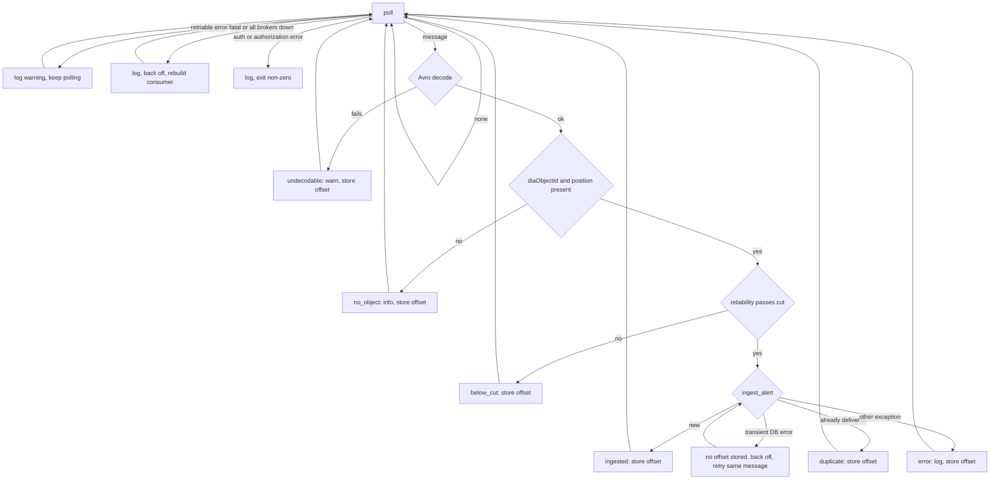
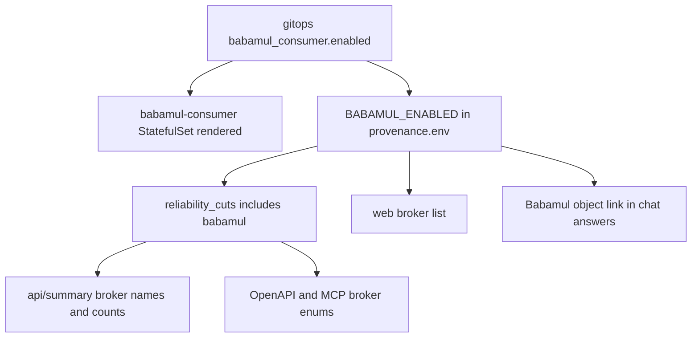

# Babamul as a Fourth Alert Broker - Plan

## Goal Capsule

- **Objective:** Rubin alerts that Babamul passes through are crossmatched and published like those from ANTARES, Lasair and Pitt-Google, and Babamul is named wherever users see the list of brokers.
- **Means:** A direct Kafka/Avro consumer, plus one per-cluster switch that turns on both the consumer and the user-facing listing (KTD1, KTD2).
- **Product authority:** this Product Contract (issue scimma/crossmatch-service#128). The maintainer owns:
  - the Babamul account and sealing its credentials on each cluster;
  - the gitops pushes and the DEV-to-PROD promotion.
- **Execution profile:** one app-repo PR (U1-U5) on a branch from up-to-date `main`. After it is released, two gitops merge requests follow. The maintainer pushes both: U6 enables DEV, and U7 enables PROD once the R14 measurement is accepted.
- **Stop conditions:**
  - Stop and report if `pip-compile` moves any package other than the `# via` annotations (KTD1).
  - Stop and report if real DEV messages show that Babamul's LSST `objectId` is not the diaObjectId (KTD8).
  - Stop and report if prior detections on `ztf-match` topics contain ZTF photometry (KTD5).
- **Open blockers:** none for planning. Deploying to a cluster requires the Babamul account (see Dependencies / Assumptions).

---

## Product Contract

Product Contract preservation: changed R13 and R14.
- R13: the user chose to link Babamul's login-gated object page, marked as needing an account, over leaving the link out.
- R14: the added-load figure now counts Alerts delivered only by Babamul, approved in review, because earliest-delivery counts include Babamul's latency lead. The brainstorm's planning questions are resolved in place by the KTDs below.

### Summary

Add a Babamul consumer that reads six of Babamul's LSST topics, applies the service's reliability cut itself, and feeds the existing alert and delivery records. Babamul then appears alongside the other three brokers in the web page, `/api/summary`, the reliability-cut provenance, the chat/MCP tools and `CONCEPTS.md`. It ships to DEV first, and PROD follows only after a measured Rubin night on DEV.

### Problem Frame

The service ingests Rubin alerts from ANTARES, Lasair and Pitt-Google. Babamul publishes Rubin alerts over its own authenticated Kafka service. Nothing in the app code, its configuration or the gitops chart refers to it.

### Key Decisions

- **Subscribe to the hosted, hostless and unknown classes, with and without a ZTF match; leave out stellar.** This is the closest match to the transient-oriented cuts the other brokers apply. Governs R1. (session-settled: user-approved — chosen over all eight LSST topics, hosted + hostless only, or measuring volume before choosing topics: matches the other brokers' transient cuts and drops the likely highest-volume variable-star class)
- **One SCiMMA Babamul account; DEV and PROD are kept apart by consumer group.** Each cluster then receives every alert independently, and only one credential set needs managing. Governs R6, R7. (session-settled: user-approved — chosen over separate DEV and PROD accounts: one credential set to seal on both clusters)
- **Full user-facing parity with the other brokers.** Governs R10-R13. (session-settled: user-approved — chosen over ingest plus counts only, or ingest hidden from users: Babamul is listed everywhere the other three are)
- **Link Babamul's object page even though it needs a login.** Governs R13. (session-settled: user-directed — chosen over no Babamul link: the page at `babamul.caltech.edu/objects/LSST/<id>` exists, and readers with a free account reach it)
- **The service enforces the reliability cut for Babamul.** Babamul's topics are split by class, not by reliability. So Babamul counts as service-enforced in provenance, like Pitt-Google, rather than broker-enforced like ANTARES and Lasair. Governs R2, R11.
- **The DEV volume measurement gates PROD.** Nobody knows the nightly rate on these six topics before connecting. Governs R14.

### Requirements

**Ingest**

- R1. The service consumes exactly these Babamul topics: `babamul.lsst.no-ztf-match.hosted`, `babamul.lsst.no-ztf-match.hostless`, `babamul.lsst.no-ztf-match.unknown`, `babamul.lsst.ztf-match.hosted`, `babamul.lsst.ztf-match.hostless`, `babamul.lsst.ztf-match.unknown`.
- R2. A Babamul alert is ingested only when its diaSource reliability is at least `MIN_DIASOURCE_RELIABILITY`. An alert with missing or null reliability is dropped, as it is on Pitt-Google today.
- R3. A Babamul alert for a diaObjectId already seen from another broker joins that existing Alert and adds a Babamul delivery. It never creates a second Alert, and repeat deliveries are idempotent, as with the other brokers.
- R4. Each ingested Babamul alert supplies the same canonical fields as the other brokers: diaObjectId, position in degrees, diaSourceId, reliability, and an event time with its basis. The event time is the first detection whenever the alert lets the service determine one. The position is the alert's diaSource position, because Babamul carries no diaObject position.
- R5. A Babamul message that cannot be decoded, or that lacks a diaObjectId or a position, is skipped and logged. The consumer keeps running.

**Operations**

- R6. DEV and PROD consume from one Babamul account under separate consumer groups. Each group carries the username prefix Babamul requires, and the groups are distinguishable as dev and prod.
- R7. The Babamul credentials live only in each cluster's sealed secrets and never in the repository.
- R8. The Babamul consumer runs as its own workload, like the other three consumers. It can be enabled or disabled per cluster, and the local compose stack includes it.
- R9. The stalled-consumer monitoring alert and the deploy contract cover the Babamul consumer alongside the other three.

**User-facing parity**

- R10. The web page's broker list includes Babamul and its subscribed topics.
- R11. `/api/summary` counts Babamul deliveries and accepts `babamul` as a broker filter. The reliability-cut provenance lists Babamul as service-enforced at the service threshold.
- R12. The chat/MCP tool descriptions and the `CONCEPTS.md` Broker entry name Babamul with the other brokers.
- R13. Chat answers offer a per-object Babamul link to Babamul's object page and say that the page needs a Babamul account.

**Rollout**

- R14. Babamul is enabled on DEV first, and three quantities are measured over at least one Rubin night before it is enabled on PROD: per-topic message count, Babamul deliveries split into new and duplicate, and Alerts in the night window delivered only by Babamul, read at least a day after the night closes. The third is the added crossmatch load the maintainer judges. Alerts first created by a Babamul delivery are also reported, as a latency figure only.

### Acceptance Examples

- AE1. **Covers R2.** Given a Babamul alert whose diaSource reliability is 0.55 and a threshold of 0.6, when the consumer receives it, then no Alert or delivery is recorded.
- AE2. **Covers R3.** Given an Alert for diaObjectId N that arrived from Lasair, when Babamul delivers an alert for N, then the Alert count for N stays at one and N has both a Lasair and a Babamul delivery. A second Babamul message for N adds nothing.
- AE3. **Covers R5.** Given a Babamul LSST alert whose diaObjectId is null, when the consumer receives it, then it logs a skip and goes on to the next message.
- AE4. **Covers R1.** Given an alert published only on `babamul.lsst.ztf-match.stellar`, then the service never receives it.

### Success Criteria

- After the first Rubin night on DEV:
  - Babamul deliveries are non-zero.
  - Alerts first created by a Babamul delivery have a non-NULL event-time basis.
  - The Babamul consumer has logged no errors other than per-message skips.
  - Crossmatch batches still finish on their usual cadence.
- The measured DEV volume (R14) is recorded, and the maintainer judges it acceptable before PROD is enabled.
- After PROD is enabled, the same signals hold on PROD for its first Rubin night.

### Scope Boundaries

- Babamul's ZTF topics (`babamul.ztf.*`) are out of scope, because they carry ZTF alerts rather than Rubin alerts.
- The `stellar` LSST topics are excluded (per R1).
- Babamul's own enrichments are not ingested or republished: its classifications, crossmatches, photometry and cutouts.
- Babamul's REST API is not used.
- The other three brokers' ingestion is not changed.
- Considered and not built:
  - **A content check on the Babamul object link.** The site returns the same page shell for every path and gates the object route behind a login, so no automated check can tell a good link from a bad one. A format test plus the DEV `objectId` check (KTD8) stand in for it. Revisit if Babamul publishes a public object page.
  - **A floor date that rejects prior detections older than the Rubin alert stream.** The DEV capture check (U6) catches contamination before PROD. Revisit if that check finds ZTF photometry in prior detections.
  - **Replaying Babamul's backlog on first start.** R14 needs one fresh night, not history. Revisit if a backfill is ever wanted.

### Dependencies / Assumptions

- The maintainer creates the SCiMMA Babamul account at https://babamul.caltech.edu/signup. The Kafka username starts with `babamul-`; the API token (`bbml_...`) is not needed. The maintainer seals the Kafka credentials on DEV, and later on PROD.
- Assumption (unverified): both Jetstream2 clusters can reach Babamul's Kafka endpoint, `kaboom.caltech.edu:9093`.
- Assumption (unverified): Babamul applies no reliability cut of its own on these topics. If it turns out to apply one, R2 still holds, because the service cut is applied regardless.
- Babamul's LSST alert schema carries diaObjectId, diaSourceId, reliability, the diaSource position, `midpointMjdTai` and prior detections. This comes from the `babamul` 0.2.0 client's models, released 2026-10-25. It has no diaObject position. ANTARES, Lasair and Pitt-Google supply one, so an Alert that Babamul creates first is positioned at a single-epoch diaSource, a known difference from the other brokers.
- Assumption (unverified, checked on DEV per KTD8): an LSST alert's top-level `objectId` is the decimal string of `candidate.diaObjectId` whenever the latter is set.

### Sources / Research

- Grounding dossier (untracked): `docs/grounding/babamul.md`. It covers the broker wiring points, the reliability standard, provenance, the compose and chart layout, and the user-facing broker lists.
- Precedent: `docs/brainstorms/2026-03-06-add-lasair-broker-brainstorm.md`, `docs/plans/2026-03-06-feat-lasair-kafka-consumer-plan.md`, `docs/plans/2026-04-03-001-feat-add-pittgoogle-alert-consumer-plan.md`, `docs/plans/2026-10-26-1546-fix-antares-api-v2-upgrade-plan.md`.
- Reliability rule: `crossmatch/project/settings.py` (the `MIN_DIASOURCE_RELIABILITY` block). Provenance split: `crossmatch/core/provenance.py`. Pitt-Google's filter: `crossmatch/brokers/pittgoogle/consumer.py`.
- Learnings:
  - `docs/solutions/conventions/dependency-pin-upgrade-pattern-2026-05-12.md`
  - `docs/solutions/conventions/lockstep-dask-cluster-aligned-upgrade-rollout.md`
  - `docs/solutions/runtime-errors/consumer-loop-stale-db-connection.md`
  - `docs/solutions/integration-issues/create-index-concurrently-deadlocks-under-locked-init.md`
  - `docs/solutions/conventions/argocd-apps-applied-manually.md`
- Babamul:
  - client and topics: https://pypi.org/project/babamul/ and https://github.com/boom-astro/babamul;
  - system paper: https://arxiv.org/abs/2511.00164;
  - the site's route table, read from its JavaScript bundle on 2026-11-11, has `/objects/:survey/:objectId` behind its login guard.

---

## Planning Contract

### Key Technical Decisions

- KTD1. **Read the stream with `confluent-kafka` and `fastavro` directly; do not use the `babamul` client.** Both are already in `crossmatch/requirements.lock` (2.13.0 and 1.12.2). `confluent_kafka` is already a direct dependency in `requirements.base.txt`; `fastavro` arrives only through hop-client and pittgoogle-client. The client has three problems:
  - It makes a network call to PyPI on import.
  - It raises raw fastavro errors out of its iterator, so one bad message ends the loop (against R5).
  - It would add `matplotlib`.

  Add `fastavro` to `requirements.base.txt` as a bare name, matching the file's convention for non-Dask packages, so a future hop-client or pittgoogle-client change cannot drop it silently. Then regenerate the lock the CI way. The expected lock diff is one line: fastavro's `# via` block gains `-r requirements.base.txt`. No Dask-boundary package moves, and no Dask image or tag change is needed beyond the usual lockstep tag bump.
- KTD2. **One enablement switch drives the consumer and every user-facing listing.** A `BABAMUL_ENABLED` setting (default false) gates:
  - Babamul's entry in `reliability_cuts()`;
  - the web broker list;
  - the summary broker names and counts;
  - the OpenAPI and MCP broker enums and prose;
  - the Babamul link.

  In gitops, one value, `babamul_consumer.enabled`, both renders the StatefulSet and sets `BABAMUL_ENABLED` through the shared `provenance.env` block that web, celery and the consumers all include. Without this switch, PROD would name Babamul as soon as the shared image was promoted, before it consumed anything (R8, R10-R14).

  The switch governs broker listings, not stored data. Turning it off after Babamul has delivered removes Babamul from the broker lists, the per-broker counts, the broker filter and the link. Window totals and per-object broker fields (`first_broker`, `brokers` in summary rows and lookups) keep reporting the stored deliveries, as they do for any stored data.
- KTD3. **At-least-once delivery.** Offsets are stored only after a message reaches a final outcome: ingested, duplicate, below cut, skipped, or error.
  - **Transient database errors** (`django.db.OperationalError`, `InterfaceError`) retry the same message in place on the same consumer, with the 1 s to 60 s backoff, until it succeeds. The consumer is not rebuilt for them. A rebuild on a new group with no committed offset would reset to `latest` and skip the failed message.
  - **Any other exception** from normalize or `ingest_alert` is the final `error` outcome. It is logged with topic, partition and offset, counted, its offset stored, and the next message processed, as the ANTARES consumer does. This way a message that always fails cannot wedge its partition.

  Idempotent ingest (R3) makes redelivery safe. `auto.offset.reset` is `latest`, so a new group starts at the newest messages (see Scope Boundaries).
- KTD4. **The consumer group is `<username>-<suffix>`.** The suffix comes from `BABAMUL_GROUP_ID`, and code adds the username prefix the same way the client does. The suffix is required and there is no timestamped fallback, because Babamul offsets live server-side per group. The suffixes are:
  - compose: `scimma-crossmatch-local`;
  - DEV: `scimma-crossmatch-dev`;
  - PROD: `scimma-crossmatch-prod`.

  The distinct compose suffix stops a laptop from stealing partitions from the DEV pod (R6).
- KTD5. **The event time comes from LSST data only.** The chain, first match wins:
  - the earliest of the finite prior-detection times (`prv_candidates[].jd`, converted with `mjd = jd - 2400000.5`) and `candidate.midpointMjdTai` gives `first_detection`, when any prior detection is usable;
  - otherwise `candidate.midpointMjdTai` gives `later_detection`;
  - otherwise ingest time gives `ingest_time`.

  This mirrors `normalize_pittgoogle`'s fallback. Never read `candidate.jdstarthist`, `fp_hists` or `survey_matches`. On `ztf-match` topics they can carry ZTF history, which is the same class of mistake as the ANTARES oldest-alert bug (R4).
- KTD6. **Babamul alerts are normalized in `normalize_babamul` in `crossmatch/brokers/normalize.py`, and the reliability check lives in a pure helper.** The normalizer maps:
  - `int(candidate.diaObjectId)` and `candidate.diaSourceId` to the ids;
  - `candidate.ra/dec` to the position;
  - `candidate.reliability` to the reliability.

  It skips the alert when the diaObjectId or position is missing. The stored payload is a JSON-safe subset: `objectId`, `candid`, topic and `candidate`, with non-finite floats set to null. It drops the cutout bytes, prior detections, forced photometry and survey matches. The reliability helper uses Pitt-Google's semantics: a missing, null, bool or non-finite score, or one below the threshold, is dropped (R2, R4, R5).
- KTD7. **The R14 measurement needs one new metric and one query, and no new stored data.** A counter `crossmatch_babamul_messages_total{topic,outcome}` takes the outcomes `ingested`, `duplicate`, `below_cut`, `no_object`, `undecodable` and `error`. The existing `crossmatch_alerts_ingested_total{broker="babamul",result}` already splits new from duplicate deliveries. The two Alert figures are one-off read-only queries over Alerts in the night window, run at least a day after it closes:
  - added load: Alerts whose only `alert_deliveries` rows are `babamul`;
  - latency figure: Alerts whose earliest `alert_deliveries.ingest_time` row is `babamul`. For the Success Criteria cadence check, batch cadence is reconstructed from the database as in earlier runtime checks (R14).
- KTD8. **The Babamul link is `https://babamul.caltech.edu/objects/LSST/{diaObjectId}`**, from a `BABAMUL_OBJECT_URL_TEMPLATE` setting. It is emitted with the ANTARES and Lasair links only when Babamul is enabled. The MCP tool text and server instructions say that Babamul pages need a free Babamul account. The path segment is Babamul's `objectId`. The plan assumes it equals the diaObjectId for LSST alerts, and U6 checks this against real DEV messages (R13).
- KTD9. **Fail loudly on configuration problems; skip per message on data problems.** `msg.error()` codes are classified:
  - **Configuration** — missing credentials, `_AUTHENTICATION`, `TOPIC_AUTHORIZATION_FAILED`, `GROUP_AUTHORIZATION_FAILED`: log an error and exit non-zero. The pod then crash-loops and the stalled-consumer alert, which watches ready replicas, fires.
  - **Fatal or all-brokers-down** — `error.fatal()`, `_ALL_BROKERS_DOWN`: back off from 1 s to 60 s and rebuild the consumer.
  - **Everything else** — `_TRANSPORT`, `_PARTITION_EOF`, `UNKNOWN_TOPIC_OR_PART` and other retriable codes: log a warning and keep polling on the same consumer. librdkafka recovers from these by itself, and a rebuild would force a needless group rejoin on all six topics.

  An undecodable or unusable message is logged with its topic, counted, stored as handled, and skipped (R5, R9).
- KTD10. **`_SERVICE_ENFORCED` in `crossmatch/core/provenance.py` becomes a tuple filtered by enablement.** Adding Babamul changes the `ProvenanceSet` content hash. Enabling Babamul on a cluster therefore creates a new provenance row, and old records keep the three-broker set. That is expected and gets a CHANGELOG line (R11).

### High-Level Technical Design

Per-message outcomes in the consumer. Each final outcome increments the KTD7 counter and stores the offset (KTD3).

The enablement switch fans out from one gitops value (KTD2):

### Assumptions

- Babamul message values are Avro Object Container Files with the schema embedded. The decode is `fastavro.reader` over the bytes, then the first record. This follows the client's `avro.py`.
- The Kafka settings are those the client uses:
  - `security.protocol=SASL_PLAINTEXT` and `sasl.mechanism=SCRAM-SHA-512`;
  - bootstrap server `kaboom.caltech.edu:9093`; the backup `babamul.umn.edu:9093` is not used.
- An LSST alert's prior detections (`prv_candidates`) are LSST photometry. ZTF photometry sits under `survey_matches`. U6 verifies this on DEV.

### Risks

- **The Babamul transport is unencrypted.** Port 9093 does not answer a TLS handshake (checked 2026-11-11), so SASL_SSL is not available. SCRAM keeps the password off the wire, but the alert stream has no integrity protection. Someone on the network path could alter or inject alerts, and their crossmatches would be published. The service already accepts the same exposure from Lasair's plaintext port 9092. If Babamul adds a TLS listener, switching is a KTD9 configuration change.
- **The fake-client tests cannot show how real librdkafka reports bad SCRAM credentials.** If wrong credentials surface as repeated retriable errors rather than `_AUTHENTICATION`, the pod stays Ready and keeps retrying. U6's first DEV start, with a deliberately wrong password tried once before the real one, shows which error code appears.
- **The DEV checks in U6 run after DEV has stored Babamul-created Alerts.** Event time and its basis are first-seen and never backfilled. If a check fails, those DEV Alerts keep the bad values, and a fix needs another app release before U7.

---

## Implementation Units

### U1. Babamul settings, enablement switch, and provenance registration

**Goal:** Add the Babamul configuration and the one switch that every user-facing listing follows.

**Requirements:** R6, R8, R11; KTD2, KTD4, KTD8, KTD10.

**Dependencies:** none.

**Files:**
- `crossmatch/project/settings.py`
- `crossmatch/core/provenance.py`
- `crossmatch/core/models.py` (the stale broker comment on `AlertDelivery.broker`)
- `crossmatch/tests/test_provenance_builder.py`
- `crossmatch/tests/test_crossmatch_provenance.py`

**Approach:**
1. Add a Babamul settings section that follows the Lasair and ANTARES sections. It defines:
   - `BABAMUL_ENABLED`, a boolean defaulting to false;
   - `BABAMUL_KAFKA_SERVER`, defaulting to `kaboom.caltech.edu:9093`;
   - `BABAMUL_KAFKA_USERNAME` and `BABAMUL_KAFKA_PASSWORD`;
   - `BABAMUL_GROUP_ID`, the suffix;
   - `BABAMUL_TOPICS`, a comma list defaulting to the six R1 topics;
   - `BABAMUL_OBJECT_URL_TEMPLATE`.
2. Update the broker-list comment in the `MIN_DIASOURCE_RELIABILITY` block.
3. Make `_SERVICE_ENFORCED` a tuple and loop over it in `reliability_cuts()`, including `babamul` only when `BABAMUL_ENABLED` is true (KTD10). Keep the current order, with Babamul last.

**Patterns to follow:** the settings sections for Lasair and ANTARES; `reliability_cuts()` as it stands today.

**Test scenarios:**
- With `BABAMUL_ENABLED` false, `reliability_cuts()` returns exactly the current three entries in the current order, and the provenance content hash is unchanged.
- With `BABAMUL_ENABLED` true, a fourth entry for `babamul` appears last, marked service-enforced at `MIN_DIASOURCE_RELIABILITY`.
- With `BABAMUL_ENABLED` true, the provenance content hash differs from the disabled hash.
- `BABAMUL_TOPICS` unset yields exactly the six R1 topics and no `stellar` topic. Covers AE4.

**Verification:** existing provenance tests pass unchanged with the switch off; the new enabled cases pass.

### U2. Babamul normalizer and reliability helper

**Goal:** Turn a decoded Babamul LSST alert into the canonical ingest dict, or a skip reason.

**Requirements:** R2, R3, R4, R5; KTD5, KTD6.

**Dependencies:** U1.

**Files:**
- `crossmatch/brokers/normalize.py`
- `crossmatch/tests/fixtures/brokers/babamul_alert.json` (new, schema-faithful, not recorded)
- `crossmatch/tests/test_broker_decoding.py`
- `crossmatch/tests/test_read_model_ingest.py`

**Approach:**
1. Add `normalize_babamul(record, topic)` per KTD6, and a pure reliability check shared with the consumer.
2. Reuse `_mjd`, `_mjd_to_datetime` and `Basis`, and implement the KTD5 chain.
3. Coerce the diaObjectId with `int()`, never through a float.
4. Build the payload subset with the same non-finite coercion `matching/payload.py` applies.

**Patterns to follow:** `normalize_pittgoogle`, including its defensive skipping of malformed history entries; the schema-faithful fixtures and tests in `test_broker_decoding.py`.

**Test scenarios:**
- A fixture alert is encoded to Avro container bytes with `fastavro.writer` and a minimal schema, then decoded with `fastavro.reader`, normalized and ingested. The Alert has the fixture's diaObjectId (int64-sized), diaSourceId, diaSource position and reliability.
- The fixture's prior detections are earlier than the alert midpoint. The event time is the earliest prior detection converted from JD, with basis `first_detection`.
- No prior detections, or only non-finite ones, gives the alert midpoint with basis `later_detection`.
- A `jdstarthist` value earlier than every prior detection, and ZTF entries under `survey_matches`, are both ignored for the event time.
- Reliability 0.55 with a threshold of 0.6 fails the cut. Covers AE1.
- Reliability 0.6 passes. Missing, null, `True` and NaN each fail.
- A null `candidate.diaObjectId` gives a no-object skip, not an exception. Covers AE3.
- A missing `ra` gives the same skip.
- The stored payload has no bytes values and no NaN, and `json.dumps` accepts it.
- An Alert first created by Lasair keeps its event time and basis when Babamul later delivers the same diaObjectId. The Babamul delivery is recorded, and a second Babamul delivery adds nothing. Covers AE2.

**Verification:** all scenarios pass in-container. `ingest_alert` is the only ORM path the normalizer's output takes.

### U3. Babamul consumer, command and metric

**Goal:** A long-running consumer that follows the KTD3 and KTD9 outcome flow and records the KTD7 counter.

**Requirements:** R1, R5, R6, R8, R14; KTD3, KTD4, KTD7, KTD9.

**Dependencies:** U1, U2.

**Files:**
- `crossmatch/brokers/babamul/__init__.py` (new)
- `crossmatch/brokers/babamul/consumer.py` (new)
- `crossmatch/project/management/commands/run_babamul_ingest.py` (new)
- `crossmatch/entrypoints/run_babamul_ingest.sh` (new)
- `crossmatch/core/metrics.py`
- `crossmatch/tests/test_babamul_consumer.py` (new)

**Approach:**
1. Shape the consumer on `crossmatch/brokers/antares/consumer.py`:
   - an outer loop that builds a `confluent_kafka.Consumer` subscribed to `BABAMUL_TOPICS`;
   - an inner poll loop that dispatches each message through the outcome flow in the High-Level Technical Design.
2. Kafka config comes from the KTD3 and Assumptions values. Disable automatic offset storing and store each offset explicitly after a final outcome, keeping periodic commits.
3. Refuse to start, exiting non-zero, when the username, password or group suffix is empty.
4. Route every alert through `brokers.ingest_alert`, so the stale-connection recycle applies, and touch no ORM outside it.
5. The management command starts the metrics server and then the consumer. Copy it from `run_lasair_ingest`.
6. The entrypoint copies `run_lasair_ingest.sh`, including `django_init.sh`, so the consumer runs `locked_init` like the other consumers.

**Execution note:** Write the consumer-loop tests against fake messages first. The outcome flow is the contract.

**Patterns to follow:**
- `crossmatch/brokers/antares/consumer.py`, for skipping undecodable messages on the same client and rebuilding on transport errors;
- `crossmatch/tests/test_antares_consumer.py`, for the `_Stop` sentinel, a scripted fake client, patched `time.sleep` and `structlog.testing.capture_logs`.

**Test scenarios:**
- A valid message on `babamul.lsst.ztf-match.hosted` is ingested once. The counter records `ingested` for that topic, and the offset is stored.
- Garbage bytes log a warning naming the topic, count `undecodable`, store the offset, and the next poll is on the same consumer. Covers AE3's keep-running half.
- A message below the cut counts `below_cut`, stores the offset, and creates no Alert or delivery. Covers AE1.
- A repeat delivery counts `duplicate` and stores the offset.
- `ingest_alert` raising `OperationalError` twice and then succeeding stores no offset until the success. It retries the same message on the same consumer, never rebuilds, and finally counts `ingested`. This also covers the first message of a new group.
- `ingest_alert` raising `ValueError` counts `error`, stores the offset, and the next message is processed.
- A `_TRANSPORT` or `UNKNOWN_TOPIC_OR_PART` error logs a warning and keeps polling on the same consumer.
- `_ALL_BROKERS_DOWN` backs off and rebuilds without exiting. The backoff doubles to the 60 s cap and resets after a successful poll.
- `_AUTHENTICATION`, `TOPIC_AUTHORIZATION_FAILED` and `GROUP_AUTHORIZATION_FAILED` each log an error and exit non-zero.
- Empty credentials exit non-zero before connecting.
- The group id sent to Kafka is `<username>-<suffix>`, and an already-prefixed suffix is not prefixed twice.
- Only the R1 topics are subscribed.

**Verification:** consumer tests pass; the command imports cleanly; the counter appears on the metrics endpoint in a compose run with fake messages.

### U4. User-facing parity

**Goal:** Babamul appears wherever the other brokers do, and only while enabled.

**Requirements:** R10, R11, R12, R13; KTD2, KTD8.

**Dependencies:** U1.

**Files:**
- `crossmatch/web/config.py`
- `crossmatch/web/templates/web/brokers.html`
- `crossmatch/web/templates/web/llms.txt`
- `crossmatch/api/summary.py`
- `crossmatch/api/openapi.py`
- `crossmatch/chat_mcp/tools.py`, `crossmatch/chat_mcp/projection.py`, `crossmatch/chat_mcp/views.py`
- `CONCEPTS.md`
- `scimma_crossmatch_service_design.md`
- Tests:
  - `crossmatch/tests/test_web_pages.py`
  - `crossmatch/tests/test_llms_txt.py`
  - `crossmatch/tests/test_summary_service.py`
  - `crossmatch/tests/test_summary_window.py`
  - `crossmatch/tests/test_openapi_completeness.py`
  - `crossmatch/tests/test_chat_mcp_tools.py`

**Approach:**
1. Add a Babamul row to `brokers()` when enabled. The template renders a list of topics where today it renders one, so the six topics are readable.
2. The summary broker names, per-broker counts and filter keep deriving from `reliability_cuts()`, so a cluster that turns Babamul off reports no `babamul` key in the per-broker counts. Totals and per-object broker fields are unchanged (KTD2).
3. Build the OpenAPI and MCP broker enums from the same list. Generate the broker-naming prose in MCP and OpenAPI from it rather than hard-coding "ANTARES, Lasair, Pitt-Google".
4. Add the `babamul` link in the projection's link builder when enabled. Add the account note to the tool text and server instructions.
5. Update the `CONCEPTS.md` Broker and Reliability entries and the design doc's broker table.

**Patterns to follow:** how `broker_names()` already derives from `reliability_cuts()`; the existing Lasair and ANTARES link entries in `chat_mcp/projection.py`.

**Test scenarios:**
- With Babamul disabled, every existing three-broker assertion holds unchanged.
- With Babamul enabled:
  - the web brokers page lists Babamul with all six topics;
  - `/api/summary` objects include a `babamul` count;
  - `?broker=babamul` filters to Babamul deliveries;
  - an unknown broker still returns the existing error;
  - provenance shows Babamul service-enforced at the threshold;
  - the MCP broker enum equals the summary broker names, and the tool text mentions Babamul and the account note;
  - a lookup result for diaObjectId N carries `https://babamul.caltech.edu/objects/LSST/N` alongside the Lasair and ANTARES links.
- With Babamul disabled while Babamul deliveries exist in the database:
  - the `/api/summary` per-broker `objects` map has no `babamul` key;
  - `?broker=babamul` returns the unknown-broker error;
  - window totals still count those Alerts.
- `llms.txt` lists the enabled brokers' cuts.

**Verification:** the updated parity tests pass with the switch both off and on.

### U5. App-repo deploy plumbing and release notes

**Goal:** The consumer runs locally and is described in the app's own deploy artifacts.

**Requirements:** R7, R8, R9; KTD1, KTD4.

**Dependencies:** U3.

**Files:**
- `crossmatch/requirements.base.txt`, `crossmatch/requirements.lock`
- `docker/docker-compose.yaml`, `docker/.env.example`
- `deploy-contract.yaml`
- `kubernetes/charts/crossmatch-service/values.yaml`
- `kubernetes/charts/crossmatch-service/templates/statefulset.yaml`
- `kubernetes/charts/crossmatch-service/templates/_helpers.yaml`
- `kubernetes/dev-overrides.yaml.example`
- `CHANGELOG.md`

**Approach:**
1. Add `fastavro` to the base requirements (`confluent_kafka` is already there) and regenerate the lock the CI way: Python 3.12, `pip<26.2` with pip-tools, no `--upgrade`. Confirm the diff matches KTD1.
2. Add a `babamul-consumer` compose service, copied from `lasair-consumer`.
   - It carries `MIN_DIASOURCE_RELIABILITY` and uses group suffix `scimma-crossmatch-local`.
   - It sits under a `babamul` compose profile, so the default stack still starts without credentials.
   - Add `BABAMUL_ENABLED: "${BABAMUL_ENABLED:-false}"` to every service that reports provenance or broker lists (web, celery-worker, celery-beat, flower) and to `babamul-consumer`, so the local stack follows one switch, as KTD2 does on clusters.
3. Add a Babamul block to `.env.example` with empty credentials and `BABAMUL_ENABLED=true`.
4. In `deploy-contract.yaml`:
   - add the `babamul-consumer` component;
   - add the Babamul env vars, with the credentials sourced from secret `babamul`;
   - add the consumer to `MIN_DIASOURCE_RELIABILITY`'s components and update its comment;
   - add `BABAMUL_ENABLED` to every component that reports provenance.
5. Mirror the StatefulSet and a `babamul.env` helper in the app-repo chart, disabled by default. Add a commented, disabled `babamul_consumer` block to `kubernetes/dev-overrides.yaml.example`, mirroring its Lasair block.
6. Add an `[Unreleased]` CHANGELOG entry for the new broker, the provenance-hash change on enable, and the new metric.

**Execution note:** This is mostly configuration. Prove it with a compose smoke: the stack starts without the profile, and with the profile and empty credentials the consumer exits non-zero with a clear log line.

**Patterns to follow:** the `lasair-consumer` compose service and chart block; the `antares.env` helper; `docs/solutions/conventions/dependency-pin-upgrade-pattern-2026-05-12.md`.

**Test expectation:** none, because this unit changes no behavior. The CI lock-drift check and the compose smoke are its proof.

**Verification:** lock-drift is clean; `makemigrations --check` reports nothing (no migration is expected); the compose smoke behaves as described.

### U6. Gitops: enable on DEV (maintainer pushes; after the release that carries U1-U5)

**Goal:** Babamul runs on DEV, and the first night's figures are collected.

**Requirements:** R6, R7, R8, R9, R14; KTD2, KTD4, KTD5, KTD8.

**Dependencies:** a released app version containing U1-U5, deployed to DEV in the usual lockstep tag bump; the Babamul account.

**Files (in `../crossmatch-service-k8s-gitops`):**
- `apps/crossmatch-service/values.yaml`, `apps/crossmatch-service/values-dev.yaml`
- `apps/crossmatch-service/templates/statefulset.yaml`
- `apps/crossmatch-service/templates/_helpers.yaml`
- `apps/crossmatch-service/templates/sealedsecret-dev.yaml`
- `ci/check_env_contract.py`, and the pinned `CONTRACT_REF` in `.gitlab-ci.yml`
- `apps/monitoring/templates/prometheusrule-symptom.yaml` (description text)
- `docs/kubeseal-workflow.md`

**Approach:**
1. In `values.yaml`, add `babamul_consumer` with `enabled: false`, the server, the topics and resources. In `values-dev.yaml`, set `enabled: true` and group suffix `scimma-crossmatch-dev`.
2. Copy the Lasair StatefulSet block, keeping the monitoring labels and metrics port. Include `provenance.env` and the new `babamul.env`, which reads secret `babamul`.
3. Set `BABAMUL_ENABLED` inside `provenance.env` from `babamul_consumer.enabled` (KTD2).
4. Seal the DEV `babamul` secret with `kubeseal --raw --scope namespace-wide`.
5. Add `babamul-consumer` to `KNOWN_COMPONENTS` and bump `CONTRACT_REF` to the app commit carrying the contract change.
6. After the DEV sync, run these checks on DEV:
   - capture the first few real messages read-only;
   - confirm that `objectId` equals `str(candidate.diaObjectId)` (KTD8);
   - confirm that the prior detections are LSST bands from the Rubin era, with no ZTF photometry (KTD5);
   - after the first Rubin night, collect the R14 figures and the batch-cadence reconstruction as KTD7 describes.

**Patterns to follow:** the gitops Lasair consumer block; `docs/solutions/conventions/argocd-apps-applied-manually.md`; the DEV rollout steps used for v0.17.0.

**Test expectation:** none, because this is configuration. The env-contract CI and the DEV checks in step 6 are its proof.

**Verification:**
- `babamul-consumer-0` is Ready on DEV and logs that it is listening.
- DEV's web page, `/api/summary` and provenance show Babamul.
- The KTD8 and KTD5 checks pass.
- The R14 figures are recorded.

### U7. Gitops: enable on PROD (maintainer pushes; after the R14 figures are accepted)

**Goal:** Babamul runs on PROD.

**Requirements:** R6, R7, R14.

**Dependencies:** U6's R14 figures, accepted by the maintainer.

**Files (in `../crossmatch-service-k8s-gitops`):** `apps/crossmatch-service/values-prod.yaml`, `apps/crossmatch-service/templates/sealedsecret-prod.yaml`.

**Approach:**
1. Seal the PROD `babamul` secret.
2. Set `enabled: true` and group suffix `scimma-crossmatch-prod`.
3. Promote through the tag-pinned PROD flow in `docs/prod-promotion-runbook.md`.

Add the PROD secret no earlier than this, because a missing secret blocks the pod from starting (KTD9).

**Test expectation:** none, because this is configuration.

**Verification:** PROD shows the same signals as U6 after its first Rubin night (Success Criteria).

---

## Verification Contract

| Gate | How | Applies to |
|---|---|---|
| Test suite | `docker compose --env-file docker/.env -f docker/docker-compose.yaml run --rm --no-deps celery-worker sh -c 'pip install -q -r requirements.dev.txt && python -m pytest'` | U1-U4 |
| Migration graph | `python manage.py makemigrations --check` in the same container; expect no changes | U1-U5 |
| Lock drift | Regenerate `crossmatch/requirements.lock` the CI way (Python 3.12, `pip<26.2`, `pip-tools`, `pip-compile --strip-extras --output-file=requirements.lock requirements.base.txt`). The diff is the one fastavro `# via` line. The `lock-drift` GitHub check is green | U5 |
| Formatting | `python -m black` on new files only. Do not reformat existing files the branch only edits | U1-U5 |
| Compose smoke | The stack starts without the `babamul` profile. With it and empty credentials, the consumer exits non-zero with a clear log line | U5 |
| CI on the PR | pytest and lock-drift green on the upstream PR; "no checks reported" counts as red | U1-U5 |
| Env contract | Gitops CI `check_env_contract.py` green with the new component and `CONTRACT_REF` | U6 |
| DEV checks | `objectId` equals diaObjectId; prior detections are LSST-only; the R14 figures are collected | U6 |

---

## Definition of Done

- U1-U5 are merged upstream through one PR with CI green, and the CHANGELOG `[Unreleased]` names the new broker, the metric and the provenance-hash change.
- With `BABAMUL_ENABLED` false, every user-facing surface is byte-for-byte unchanged from today, as the existing tests prove.
- With it true, AE1-AE4 are each covered by a passing test.
- U6 is deployed on DEV, its checks pass, and the R14 figures are recorded for the maintainer.
- U7 runs only after the maintainer accepts those figures.
- No experimental or abandoned code is left in the diff.
