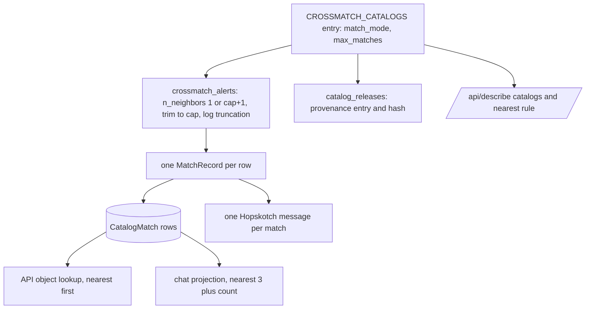

# Euclid DR1 MER Crossmatch - Plan

## Goal Capsule

- **Objective:** Subscribers and chat users see every Euclid DR1 source that coincides with a Rubin transient in the Euclid footprint, with enough photometry, classification and shape information to judge which one is the counterpart.
- **Product authority:** The SCiMMA PI asked for Euclid DR1. Scope, the multi-match behavior and the payload were settled with the maintainer on 2026-11-12. Both the Euclid MER Deep and MER Wide catalogs are in scope. Other Euclid DR1 tables are not.
- **Means:** two new `CROSSMATCH_CATALOGS` entries plus a per-catalog matching mode threaded through matching, provenance and the public surfaces (KTD1, KTD2, KTD3).
- **Authority hierarchy:** the Product Contract wins on behavior; KTDs win on mechanism within it; units override neither. Project rules in `CLAUDE.md` bind throughout.
- **Execution profile:** one pull request on the app repo (U1-U6). The gitops changes and the DEV and PROD rollout are maintainer steps that follow the merge (see Operational / Rollout Notes).
- **Who finishes:** `ce-work` implements and verifies U1-U6, pushes the branch to `bot` and opens the upstream PR. The maintainer merges, tags, wires gitops and runs the R13 measurement.
- **Stop conditions:** stop and report if an anonymous `columns="all"` read of either Euclid collection still fails from the app image after the `storage_options` fallback in U4, if lsdb rejects `n_neighbors` > 1 with the margin, or if any requirement turns out to need a dependency pin change.
- **Open blockers:** None.

---

## Product Contract

### Summary

Add Euclid DR1 MER Deep and Euclid DR1 MER Wide as two new crossmatch catalogs, read from IRSA's public HATS copies.
Matching gains a per-catalog choice between keeping only the nearest source and keeping every source within the radius; both Euclid catalogs keep every source, and the existing four catalogs stay nearest-only.
The rollout follows the established DEV-then-PROD path, gated on a measured Rubin night.

### Problem Frame

Euclid DR1 was released on 2026-11-12 and IRSA published its MER object catalogs in HATS format, so LSDB can read them directly.
Euclid's space-based VIS imaging is deeper and sharper than any catalog the service matches today, which makes it the best available view of faint and blended sources coincident with a Rubin transient. Host association at wider radii is deferred (see Scope Boundaries).

The SCiMMA PI suggested adding it and flagged the catch: at Euclid's depth, a single Rubin source can correspond to several Euclid sources, and there is no reason not to return all matches within some tolerance.
The service currently keeps only the nearest source per catalog, which would silently discard exactly the cases Euclid is best at resolving.

Rubin's overlap with Euclid comes almost entirely from two Euclid Deep Fields that are also Rubin deep-drilling fields.
Measured against 999,162 PROD alerts at HEALPix order 6, which slightly overcounts at field edges:

| | Euclid MER Deep | Euclid MER Wide |
|---|---|---|
| Sources | 51.8M | 888M |
| Size on disk | 36 GiB, 30 partitions | 733 GiB, 768 partitions |
| Sky area | about 114 deg2 | about 2,470 deg2 |
| PROD alerts in footprint, all time | 21,820 (2.2%) | 14,823 (1.5%) |
| PROD alerts in footprint, Nov 2026 | 7.6% | 3.2% |

EDF-South (RA 61, Dec -48) holds about 14,650 of those alerts and EDF-Fornax (RA 53, Dec -28) about 7,170.
Every alert in Wide coverage also falls in Deep coverage.
Wide-only sky has produced no alerts yet and will matter as Rubin's main survey reaches the southern Euclid Wide area.

### Key Decisions

- **Add both Deep and Wide in one change.** Deep covers every Euclid-overlapping alert so far at about 5% of Wide's size, so deferring it would have deferred most of the value. Governs R1. (session-settled: user-approved -- chosen over Wide only, and over Deep first with Wide later: Deep is the main overlap and adds little cost, and Wide follows the same configuration.)
- **Return every source within the radius for Euclid only.** The other four catalogs keep nearest-only, so what existing subscribers receive does not change. Governs R4, R5. (session-settled: user-approved -- chosen over multi-match for all catalogs and over nearest-only Euclid: limits the behavior change to the catalogs that need it.)
- **Keep the shared 1.0 arcsec radius.** A Euclid match keeps the same meaning as every other match, a coincident source; host association at wider radii is a different product. Governs R6. (session-settled: user-approved -- chosen over a wider Euclid-specific radius and over measuring first: keeps "match" meaning one thing across catalogs.)
- **Publish photometry, classification and morphology.** Enough to tell star from galaxy, size up a host and see whether Euclid has a spectrum, without the payload growth of the broad set. Governs R8. (session-settled: user-approved -- chosen over the lean set and the broad set: the middle set answers the counterpart question without bloating multi-match payloads.)
- **Publish Wide and Deep matches side by side, unmerged.** Where the catalogs overlap, one galaxy can appear in both under different Euclid IDs; each catalog's measurements stand on their own, and Deep's are deeper. Governs R10. (session-settled: user-approved -- accepted as part of the Wide-and-Deep scope: merging would require choosing which measurement wins.)
- **Record the matching mode in provenance.** The provenance set covers the radius and each catalog's name and release, but not nearest versus all, so switching a catalog's mode would otherwise go unrecorded. Governs R7.

### Requirements

**Catalogs**

- R1. The service crossmatches alerts against two new catalogs, Euclid DR1 MER Deep and Euclid DR1 MER Wide, each with its own catalog name and release label.
- R2. Both catalogs are read anonymously from IRSA's public HATS collections in the `nasa-irsa-euclid-dr1` S3 bucket, including their 10 arcsec margin caches.
- R3. Stored and published Euclid coordinates are each source's measured position (`ra`, `dec`), and matching agrees with that measured position, not merely with the position decoded from its object ID.

**Multi-match**

- R4. Each catalog declares whether matching keeps only the nearest source within the radius or every source within it. The existing four catalogs default to nearest, so their behavior does not change.
- R5. Both Euclid catalogs keep every source within the radius, up to a per-alert safety cap, and each kept source is a separate match.
- R6. Euclid matching uses the shared `CROSSMATCH_RADIUS_ARCSEC`, currently 1.0 arcsec.
- R7. Each catalog's matching mode is part of the recorded provenance, so a mode change produces a new provenance set.

**Published content**

- R8. Each Euclid match carries `object_id`, `ra`, `dec`, VIS PSF and Y/J/H template-fit fluxes with their errors (uJy), `point_like_prob`, `point_like_flag`, `spurious_prob`, `spurious_flag`, `det_quality_flag`, `ellipticity`, `kron_radius`, `fwhm`, `mu_max` and `has_spectrum`.
- R9. Every surface that shows matches presents all of an alert's Euclid matches, ordered by separation: the Hopskotch messages, the API and the chat answers. Chat may truncate at its existing per-catalog display cap, provided it reports the total.
- R10. Where Deep and Wide both match the same object, both matches are published as-is. The catalog documentation and the chat tool text say that this can happen and why.

**Documentation and credit**

- R11. Every place that lists the service's catalogs names the two Euclid catalogs and what their source IDs mean. That includes the chat tool text, the MCP server instructions, the API discovery output, `CONCEPTS.md` and the design document.
- R12. The catalog documentation and the web catalogs page credit Euclid and IRSA and cite the dataset DOIs their READMEs ask for.

**Rollout**

- R13. Euclid goes live on DEV first. PROD follows only after a real Rubin night on DEV shows `crossmatch_batch` runtime staying within the existing soft and hard time limits, and Dask worker memory staying within limits, with both Euclid catalogs active. That measurement covers only the Deep-Field footprint, so the runtime and memory check is repeated the first time PROD batches contain alerts in Wide-only coverage.

### Acceptance Examples

- AE1. **Covers R4, R5, R9.** Given an alert in EDF-South with three Euclid Deep sources within 1.0 arcsec and one Gaia source within 1.0 arcsec, when the batch runs, then three Euclid Deep matches and one Gaia match are stored and published. The chat answer lists the three Euclid matches nearest-first.
- AE2. **Covers R4.** Given an alert with two DES sources within 1.0 arcsec, when the batch runs, then only the nearer DES source is stored, exactly as before this change.
- AE3. **Covers R10.** Given an alert where one galaxy appears in both Deep and Wide, when the batch runs, then one Euclid Deep match and one Euclid Wide match are published, each with its own object ID and measurements.
- AE4. **Covers R5.** Given an alert with more Euclid sources inside the radius than the safety cap allows, when the batch runs, then the nearest sources up to the cap are kept, and the run log records that the cap truncated the result.
- AE5. **Covers R1.** Given an alert outside both Euclid footprints, when the batch runs, then the Euclid catalogs produce no matches and the batch succeeds, as for any non-overlapping catalog.

### Success Criteria

- On DEV, the first Rubin night with Euclid active completes every batch without a soft or hard time-limit hit or Dask worker OOM. Batch runtime with Euclid is recorded next to the measured 3.0-4.3 min baseline.
- On that night, alerts in EDF-South and EDF-Fornax receive Euclid matches, and some alerts receive more than one Euclid match from the same catalog.

### Scope Boundaries

- Deferred: a wider, host-association radius for Euclid.
- Deferred: multi-match for Gaia, DES, DELVE or SkyMapper. R4's per-catalog setting makes each a configuration change.
- Deferred: other Euclid DR1 tables, such as spectra, photometric redshifts and morphology catalogs, and Euclid DR1 data products beyond MER.
- Out of scope: merging or deduplicating Deep and Wide matches of the same object (see R10).
- Out of scope: changing `CROSSMATCH_BATCH_MAX_SIZE`. It is set through consultation with the LSDB developers. If R13's measurement shows a problem, look at worker resources or catalog column loading instead.
- Considered, not built: a custom crossmatch algorithm for measured positions (see KTD1). Revisit if a later Euclid release decodes object IDs to a position that differs from `ra`/`dec`.
- Considered, not built: a truncation flag in published payloads. KTD2 logs truncation instead, because at expected densities the cap is essentially never reached.

### Deferred to Follow-Up Work

- Euclid-specific API filter columns (`filter_columns`), such as a point-like probability filter.
- Gitops changes and the DEV and PROD rollout, which the maintainer runs after merge (see Operational / Rollout Notes).

### Dependencies / Assumptions

- IRSA's HATS collections stay at their current S3 paths and remain publicly readable. data.lsdb.io lists them, but the service reads S3 directly.
- A source's measured position and the ID-decoded position used for partitioning agree to better than 0.0005 arcsec (six sampled Deep and Wide partitions), and `lsdb.open_catalog` loads each collection's 10 arcsec margin automatically, so no match is lost at a partition edge.
- The schema already allows several matches per alert per catalog: the uniqueness key is alert, catalog, source ID and match version (`crossmatch/core/models.py`). The match-building, API and chat paths already handle lists. Each match is already its own Hopskotch message, so subscribers receive several messages for one object when Euclid returns several sources.

### Outstanding Questions

Planning resolved the earlier questions: measured-position matching (KTD1), the per-alert cap (KTD2), column loading (KTD4), names, MOC orders and key and filter columns (KTD4), `point_like_flag` nulls (KTD4), chat truncation (U5) and gitops wiring (Operational / Rollout Notes).

**Deferred to Implementation**

- Whether lsdb's default S3 handling reads IRSA's `us-east-1` bucket anonymously without `storage_options`. A direct `s3fs` read with `anon=True` from the app image succeeded; U4's live check confirms the `lsdb.open_catalog` path before merge.
- The exact dataset DOIs for R12, taken from IRSA's DOI index (`https://www.ipac.caltech.edu/dois/irsa`) when U4 writes the credit text.

### Sources / Research

- Grounding dossier, untracked: `docs/grounding/euclid-dr1-mer.md`. It covers the Wide catalog metadata, schema notes and the integration points in this repo.
- IRSA Euclid DR1 MER HATS collections: `s3://nasa-irsa-euclid-dr1/contributed/dr1/hats/reformatted_catalogs/mer_catalogue_wide_survey` and `.../mer_catalogue_deep_survey`. Each has a README with citation instructions.
- data.lsdb.io catalog pages: `https://data.lsdb.io/Euclid/Euclid_DR1/MER/Catalogue_(Wide_Survey)/` and `.../Catalogue_(Deep_Survey)`.
- Current nearest-only call: `crossmatch/matching/catalog.py` (`n_neighbors=1`).
- Provenance contents: the provenance set hashes the radius, each catalog's name and release (`crossmatch/core/provenance.py`), and the reliability cuts. It does not record nearest-versus-all, which R7 adds.
- Chat grouping and cap: `crossmatch/chat_mcp/projection.py` and `MCP_MATCHES_PER_CATALOG` in `crossmatch/project/settings.py`.
- Per-catalog payload convention: `docs/solutions/conventions/catalog-specific-payload-columns.md`.
- Measured batch runtime baseline (3.0-4.3 min per 100k batch) and time limits (soft 480 s, hard 600 s) in `crossmatch/project/settings.py`.

Product Contract preservation: changed R3 -- reworded, with the maintainer's approval, so it can be checked against matching on the equal ID-decoded position (KTD1). Dependencies / Assumptions now state the margin as a verified fact, and Outstanding Questions are resolved by planning. The other requirements, AE1-AE5 and the Key Decisions are unchanged.

---

## Planning Contract

### Key Technical Decisions

- KTD1. **Use the default LSDB matching; no custom algorithm.** In both IRSA collections the measured `ra`/`dec` equal the ID-decoded partitioning columns to better than 0.0005 arcsec (six sampled partitions), so lsdb's KdTree match, which reads the partitioning columns, agrees with the measured position as R3 requires. U4's offset scan confirms this across the catalogs before merge. The Euclid entries set `ra_column`/`dec_column` to `ra`/`dec`, so the stored and published coordinates are the measured ones. A custom algorithm would also have to be pickled by value for the Dask workers (`crossmatch/core/dask.py`), which this avoids. Governs R3.
- KTD2. **A per-catalog `match_mode` with a fixed cap, applied inside `crossmatch_alerts`.** Each `CROSSMATCH_CATALOGS` entry gains an optional `match_mode`, `nearest` by default or `all`, and `all` requires `max_matches`. Euclid uses `max_matches: 10`. In `all` mode the crossmatch asks lsdb for `max_matches + 1` neighbors within the radius, then keeps the `max_matches` nearest per alert and logs one structured warning per catalog and batch naming how many alerts were truncated (AE4). `nearest` keeps today's `n_neighbors=1` call byte-for-byte. Governs R4, R5, R6.
- KTD3. **Record the mode on each catalog's provenance entry.** `catalog_releases()` adds `match_mode` to every entry, and `max_matches` when the mode is `all`. This changes the provenance hash on deploy, which adding the catalogs does anyway. The OpenAPI `CatalogRelease` schema gains both as optional properties, because stored `ProvenanceSet.catalogs` rows predate them and are served verbatim. The replay snapshot records them too, so a mode change shows as a configuration difference. Governs R7.
- KTD4. **Euclid configuration values.**
  - Names: `euclid_dr1_mer_deep` and `euclid_dr1_mer_wide`.
  - Env vars: `EUCLID_DR1_MER_DEEP_*` and `EUCLID_DR1_MER_WIDE_*` (`_HATS_URL`, `_RELEASE`, `_FOOTPRINT_MOC_ORDER`). The URLs default to the IRSA collection roots, and the releases to `Euclid DR1 MER Deep` and `Euclid DR1 MER Wide`. MOC order defaults to 8, as for Gaia and SkyMapper.
  - `source_id_column`: `object_id`.
  - `payload_columns`: the R8 list.
  - `key_columns`: `flux_vis_psf`, `point_like_prob`, `has_spectrum`. No `filter_columns`.
  - Only the payload columns are loaded, plus the partitioning columns lsdb always adds, as for every catalog today.
  - `point_like_flag` is null when false. It is published as null, with no coercion change, and the column reference documents it.

  Governs R1, R2, R8.
- KTD5. **The public contract states the matching mode per catalog.** `/api/describe` adds `match_mode` and `max_matches` to each `catalogs[]` entry. `crossmatch.nearest_source_per_catalog` stays in the schema but becomes true only when every configured catalog is `nearest`, so it is false once Euclid is configured. `NEAREST_SOURCE_RULE` is rewritten so it names the exception, and that text flows to the OpenAPI document and llms.txt. `CONTRACT_VERSION` goes from 1.0.0 to 1.1.0. Governs R9, R11.
- KTD6. **The API orders each object's matches by separation.** `api/service.py` `_load_matches` keeps its DISTINCT ON de-duplication. It then sorts each object's matches by separation, with catalog and source ID as tie-breaks, so a nearer Wide match lists before a farther Deep one. Governs R9.
- KTD7. **Credit through an optional per-catalog `credit` key.** The key holds `text` and `url`. `web/config.catalogs()` passes it through and `web/templates/web/catalogs.html` renders it when present. Only the Euclid entries set it. Governs R12.
- KTD8. **A per-catalog enable switch for the Euclid entries.** `EUCLID_DR1_MER_DEEP_ENABLED` and `EUCLID_DR1_MER_WIDE_ENABLED` default to true, are read in `settings.py`, and leave a disabled entry out of `CROSSMATCH_CATALOGS` entirely. Matching, provenance, `/api/describe`, the chat text and the web page then all omit it, and the provenance set records the change. This lets the maintainer switch Wide off on PROD through gitops if Wide reads threaten the batch time limit, without a new image. Governs R13.

### High-Level Technical Design

The matching mode is decided once per catalog in settings and read in three places, so it cannot disagree between what was run, what was recorded and what is advertised.

### Assumptions

- The Dask workers run lsdb 0.11.0, matching the app pin, so `n_neighbors` > 1 with a margin behaves as in the inspected source. No pin changes.
- Per-row match building, persistence and notification already handle several rows for one object and catalog (`crossmatch/tasks/crossmatch.py` `_catalog_records`, `_persist_catalog`). This plan adds tests rather than code there.

---

## Implementation Units

### U1. Per-catalog matching mode

**Goal:** Matching keeps the nearest source or every source within the radius, per catalog, with a capped and logged result for `all`.

**Requirements:** R4, R5, R6; KTD2; AE1, AE2, AE4.

**Dependencies:** none.

**Files:**
- `crossmatch/project/settings.py` (validator for `match_mode` / `max_matches`)
- `crossmatch/matching/catalog.py` (`crossmatch_alerts`)
- `crossmatch/tests/test_catalog_validation.py`
- `crossmatch/tests/test_catalog_crossmatch_call.py` (new)
- `crossmatch/tests/test_crossmatch_compute.py`

**Approach:**
1. Add `_validate_match_modes` after `_validate_key_columns`, in the same shape as `_validate_footprint_moc_orders`:
   - a missing `match_mode` means `nearest`;
   - only `nearest` or `all` are valid;
   - `all` requires an integer `max_matches` of at least 2, with bools rejected;
   - `max_matches` without `all` is an error.
2. In `crossmatch_alerts`, choose `n_neighbors` from the entry. For `all`, after `compute()`, sort by alert ID and `_dist_arcsec`, keep the first `max_matches` rows per alert, and log `crossmatch_match_cap_reached` with the catalog and the number of truncated alerts.
3. Leave the `nearest` path's call arguments exactly as today.

**Patterns to follow:** the validators and `ImproperlyConfigured` messages in `settings.py`; structlog usage in `matching/catalog.py`; `_read_with_retry` stays the wrapper.

**Test scenarios:**
- A catalog entry without `match_mode` validates and behaves as `nearest`.
- `match_mode: 'all'` without `max_matches` raises `ImproperlyConfigured` naming the catalog.
- `max_matches: True`, `max_matches: 1` and `match_mode: 'every'` each raise.
- `max_matches` on a `nearest` entry raises.
- Covers AE2. With `lsdb.open_catalog` and the alerts catalog mocked, a `nearest` entry calls `crossmatch` with `n_neighbors=1` and the configured radius.
- An `all` entry with `max_matches: 10` calls `crossmatch` with `n_neighbors=11`.
- Covers AE4. An `all` result with 12 rows for one alert and 2 for another returns 10 plus 2 rows, the 10 nearest, and logs one truncation warning reporting 1 alert.
- An `all` result under the cap returns every row unchanged and logs nothing.
- Covers AE1. In `compute_crossmatch`, with `crossmatch_alerts` mocked to return three rows for one object from an `all` catalog and one row from Gaia, there are 4 `CatalogMatch` rows and 4 notifications.

The new call test sits at the `crossmatch_alerts` boundary. It catches wrong `n_neighbors` or trimming, but not lsdb's own neighbor search, which R13's DEV run exercises.

**Verification:** existing catalog and compute tests still pass, unchanged, for the four `nearest` catalogs.

### U2. Matching mode in provenance and replay

**Goal:** A catalog's matching mode is part of the recorded provenance and of the replay tool's comparison.

**Requirements:** R7; KTD3.

**Dependencies:** U1.

**Files:**
- `crossmatch/core/provenance.py` (`catalog_releases`)
- `crossmatch/api/openapi.py` (`CatalogRelease` schema)
- `crossmatch/replay/snapshot.py`
- `crossmatch/replay/compare.py`
- `crossmatch/tests/test_provenance_builder.py`
- `crossmatch/tests/test_crossmatch_provenance.py`
- `crossmatch/tests/test_replay_compare.py`

**Approach:**
1. `catalog_releases()` emits `match_mode` for every catalog and `max_matches` when the mode is `all`. Update `test_provenance_builder.py`'s exact-list assertion accordingly.
2. The `CatalogRelease` schema lists both as optional, so stored provenance without them still validates.
3. Replay `_crossmatch_config` records both fields. `compare.py` keeps its (object, catalog) key and `SOURCE_CHANGED` for catalogs recorded as `nearest`. For catalogs recorded as `all` it keys by object, catalog and source ID and reports matches present only in the baseline or only in the candidate, instead of overwriting.

**Patterns to follow:** `test_enabling_babamul_changes_the_provenance_content_hash` is the template for the hash-change test.

**Test scenarios:**
- Switching one catalog from `nearest` to `all` changes the provenance content hash.
- A stored provenance set without `match_mode` still serializes through an object lookup and passes the OpenAPI contract validator.
- In replay compare, two baseline matches for one object in an `all` catalog with different source IDs are both counted, and one missing from the candidate is reported, not silently dropped.
- In replay compare, a `nearest` catalog whose matched source changed still reports `SOURCE_CHANGED` (`test_matched_source_changed` unchanged).
- In replay compare, a configuration differing only in `match_mode` is flagged as a configuration difference.

**Verification:** `pset.catalogs == catalog_releases()` still holds in `test_crossmatch_provenance.py`.

### U3. Public API contract and ordering

**Goal:** The API advertises each catalog's matching mode truthfully and returns each object's matches nearest-first.

**Requirements:** R9, R11; KTD5, KTD6.

**Dependencies:** U1.

**Files:**
- `crossmatch/api/discovery.py` (`NEAREST_SOURCE_RULE`, describe payload, `_SOURCE_ID_MEANINGS`)
- `crossmatch/api/openapi.py` (describe schema)
- `crossmatch/api/service.py` (`_load_matches`)
- `crossmatch/core/provenance.py` (`CONTRACT_VERSION`)
- `crossmatch/tests/test_api_describe.py`
- `crossmatch/tests/test_object_lookup_service.py`
- `crossmatch/tests/test_llms_txt.py`
- `crossmatch/tests/test_openapi_completeness.py`

**Approach:**
1. Describe adds `match_mode` and `max_matches` to each catalog. `nearest_source_per_catalog` is computed rather than a constant.
2. Rewrite `NEAREST_SOURCE_RULE` to say that catalogs in `all` mode return every source within the radius, up to their cap, nearest first.
3. Add `_SOURCE_ID_MEANINGS` entries for both Euclid names (the Euclid MER `object_id`).
4. Sort the matches `_load_matches` returns per object by separation, then catalog, then source ID (KTD6).
5. Bump `CONTRACT_VERSION` to 1.1.0.

**Test scenarios:**
- Describe with only `nearest` catalogs reports `nearest_source_per_catalog: true` and `match_mode: 'nearest'` on each catalog.
- Describe with an `all` catalog reports false and that catalog's `max_matches`.
- The describe response validates against the updated OpenAPI schema.
- An object with three matches in one catalog at 0.8, 0.2 and 0.5 arcsec returns them in the order 0.2, 0.5, 0.8.
- An object with a Deep match at 0.6 arcsec and a Wide match at 0.3 arcsec returns the Wide match first.
- llms.txt contains the rewritten rule text.
- An unlisted catalog name still falls back to the generic source-ID meaning.

**Verification:** `test_api_contract.py` passes with the response validator active.

### U4. Euclid catalog entries, wiring and credit

**Goal:** Both Euclid catalogs are configured, deployable and documented, with their credit shown.

**Requirements:** R1, R2, R3, R8, R10, R12, R13; KTD1, KTD4, KTD7, KTD8.

**Dependencies:** U1.

**Files:**
- `crossmatch/project/settings.py` (URLs, releases, MOC orders, two `CROSSMATCH_CATALOGS` entries)
- `docker/docker-compose.yaml`
- `docker/.env.example`
- `kubernetes/charts/crossmatch-service/values.yaml`
- `kubernetes/charts/crossmatch-service/templates/_helpers.yaml`
- `kubernetes/dev-overrides.yaml.example`
- `deploy-contract.yaml`
- `crossmatch/web/config.py`
- `crossmatch/web/templates/web/catalogs.html`
- `scripts/dump_catalog_columns.py`
- `docs/references/euclid_dr1_mer_deep-columns.md` and `docs/references/euclid_dr1_mer_wide-columns.md` (new, generated)
- `crossmatch/tests/test_catalog_config.py`
- `crossmatch/tests/test_web_config.py`
- `crossmatch/tests/test_web_pages.py`
- `crossmatch/tests/test_payload.py`
- `crossmatch/tests/test_api_describe.py` (`DEFAULT_ORDERS`)
- `crossmatch/tests/test_summary_service.py` (`CATALOGS`)
- `crossmatch/tests/test_chat_mcp_projection.py` (`key_columns` dict)

**Approach:**
1. Add the env vars and both entries per KTD4, after SkyMapper, with `match_mode: 'all'`, `max_matches: 10`, `ra_column: 'ra'`, `dec_column: 'dec'` and a `credit` entry (KTD7). Add the two `*_ENABLED` switches (KTD8), and mark them `optional: true` in `deploy-contract.yaml`.
2. Mirror the DELVE and SkyMapper wiring in compose, the env example, the chart, dev-overrides and `deploy-contract.yaml` (`*_HATS_URL` for celery-worker, celery-beat and flower).
3. Add both catalogs to `scripts/dump_catalog_columns.py` and generate the two reference files. Note `point_like_flag`'s null-when-false semantics in them.
4. Fix the three tests that hard-code the four-catalog list.

**Execution note:** before merging, run an anonymous `lsdb.open_catalog(<collection>, columns="all")` for both URLs from the app image, and a small `crossmatch` of a few known EDF-South positions against Deep, to confirm R2 and KTD1 end to end. Also scan the `ra`/`dec` versus `ra_from_object_id`/`dec_from_object_id` offset over every Deep partition and every tenth Wide partition, reading only those four columns. Stop and report if any offset exceeds 0.001 arcsec. If either read needs `storage_options`, add them to both `open_catalog` calls in `matching/catalog.py` and say so in the PR.

**Patterns to follow:** commits 8fb848b (DELVE) and 6b079ea (SkyMapper); `docs/solutions/conventions/catalog-specific-payload-columns.md`.

**Test scenarios:**
- Both Euclid entries pass every import-time validator. Their `payload_columns` include `object_id`, `ra` and `dec`, and none collides with an alert column.
- Setting `EUCLID_DR1_MER_WIDE_HATS_URL` in the environment overrides the default URL.
- With `EUCLID_DR1_MER_WIDE_ENABLED=false`, `CROSSMATCH_CATALOGS` has no Wide entry, `catalog_releases()` and `/api/describe` omit it, and Deep is unaffected.
- An unparseable `*_ENABLED` value raises `ImproperlyConfigured`.
- The catalogs page shows both Euclid catalogs with their credit text and link. A catalog without `credit` renders no credit line.
- A payload row with `point_like_flag` null, `has_spectrum` as `uint8` 1 and an int16 `det_quality_flag` coerces to null, 1 and an int.
- Covers AE5. A batch where both Euclid catalogs raise "Catalogs do not overlap" ends with the no-overlap outcome for them, and the batch succeeds.

**Verification:** both helm renders succeed, compose config validates, and the live read and crossmatch check above passes.

### U5. Chat surfaces and documentation

**Goal:** Every place that names the service's catalogs includes Euclid and explains several matches and Deep/Wide duplicates.

**Requirements:** R9, R10, R11, R12.

**Dependencies:** U4.

**Files:**
- `crossmatch/chat_mcp/tools.py` (`_CATALOGS` and the summary-tool mapping sentence)
- `crossmatch/chat_mcp/views.py` (server instructions)
- `crossmatch/tests/test_chat_mcp_tools.py`
- `crossmatch/tests/test_chat_mcp_projection.py`
- `CONCEPTS.md` (HATS catalog, Match)
- `scimma_crossmatch_service_design.md` (catalog registry, margin table, the `n_neighbors=1` rule, env var list)
- `CHANGELOG.md` (`[Unreleased]`)

**Approach:**
1. Name both Euclid catalogs in the tool text and the server instructions.
2. Add one sentence: Euclid catalogs can list several coincident sources, nearest first, and the same galaxy can appear in both Deep and Wide under different IDs.
3. Update the Match entry in `CONCEPTS.md` for per-catalog matching mode.
4. Add the CHANGELOG entry, noting the new provenance set and the contract version bump.

**Test scenarios:**
- Tool descriptions and server instructions name both Euclid catalogs and the duplicate note.
- Covers AE1. A projection with 12 matches from `euclid_dr1_mer_deep` shows the nearest 3, with count 12 and `more` 9.
- Projection key columns for both Euclid catalogs are the KTD4 set.

**Verification:** no hard-coded four-catalog list remains (`rg` for "SkyMapper DR4" across `crossmatch/` and the docs lists Euclid alongside).

### U6. Rollout guidance in the repo

**Goal:** The maintainer can wire, measure and promote Euclid without reconstructing the steps.

**Requirements:** R13; Success Criteria.

**Dependencies:** U4.

**Files:**
- `docs/developer.md` (or the existing catalog section it points to)
- The PR body (rollout steps)

**Approach:** Record the Operational / Rollout Notes below as a short "Adding or measuring a catalog" note, and repeat the steps in the PR body.

**Test expectation:** none -- documentation only.

**Verification:** the note names the gitops values, the contract-ref ordering, the DEV measurement and the Wide-only re-check trigger.

---

## Operational / Rollout Notes

1. **Gitops, DEV.** Add `euclid_dr1_mer_{deep,wide}_hats_url` and `_release` values to `apps/crossmatch-service/values.yaml`. Deliver them through the `provenance.env` helper with the other catalogs. Only after that, bump `CONTRACT_REF` in `.gitlab-ci.yml` past the app commit that adds them to `deploy-contract.yaml`, because the contract check fails on contract vars missing from the render.
2. **DEV.** Deploy the release image. The first batch records a new provenance set. Check the logs for `crossmatch_match_cap_reached`.
3. **Measure one Rubin night (R13).**
   - `crossmatch_batch` runtime against the 480 s soft and 600 s hard limits, next to the 3.0-4.3 min baseline;
   - peak Dask worker memory against the 8Gi limit;
   - Euclid matches in EDF-South and EDF-Fornax, including some objects with several matches from one catalog.
4. **PROD.** Promote all four apps per the gitops `docs/prod-promotion-runbook.md`.
5. **Wide-only re-check.** Repeat step 3 the first time PROD batches contain alerts in Wide-only coverage. If Wide threatens the time limits, set `EUCLID_DR1_MER_WIDE_ENABLED=false` in the PROD gitops values (KTD8) while the cause is investigated.
6. **Expected side effect.** The App dashboard's "matches / alert" panel rises once Euclid is live, because it counts matches, not objects.

### Risks

- **Wide read time.** Reading 6 columns of one 1 GiB Wide partition took 5-20 s from outside the cluster. About 20 payload columns per touched partition, inside a 480 s soft limit, is the main runtime risk. Today's alerts touch few Wide partitions, which is why R13 has the Wide-only re-check. `SoftTimeLimitExceeded` must keep propagating through any new code path (`docs/solutions/integration-issues/soft-time-limit-swallowed-by-exception-classifier.md`).
- **Message volume.** Subscribers receive one Hopskotch message per Euclid match. At about 0.1 unrelated sources per 1 arcsec circle, this adds little volume.

---

## Verification Contract

| Check | Command or evidence | Proves |
|---|---|---|
| Unit and integration tests | `docker compose --env-file docker/.env -f docker/docker-compose.yaml run --rm --no-deps celery-worker sh -c 'pip install -q -r requirements.dev.txt && python -m pytest'` | U1-U5 behavior, existing catalogs unchanged |
| No migration | `python manage.py makemigrations --check` in the same container | no schema change was needed |
| Chart render | `helm template` of `kubernetes/charts/crossmatch-service` with default values and with `kubernetes/dev-overrides.yaml.example` | U4 wiring renders |
| Live catalog check | U4's execution-note read and crossmatch from the app image | R2 anonymous access, KTD1 positions |
| Formatting | `black` on new Python files and on new functions only; do not reformat existing lines | project formatting rule without churn |

---

## Definition of Done

- U1-U5 are implemented, with their test scenarios passing in the container, and U6's note is written.
- The full test suite passes, `makemigrations --check` is clean and both chart renders succeed.
- The live catalog check passed and its result is quoted in the PR body.
- `nearest` catalogs produce byte-identical crossmatch calls and payloads to today. The only intended differences for them are their provenance entries, describe fields and API ordering.
- `CHANGELOG.md` `[Unreleased]` describes both catalogs, multi-match, the provenance change and the contract version bump.
- No experimental or abandoned code remains in the diff, and no dependency pin changed.
- The PR is open on `scimma/crossmatch-service` from the `bot` remote with the rollout steps in its body. The merge is the maintainer's.
